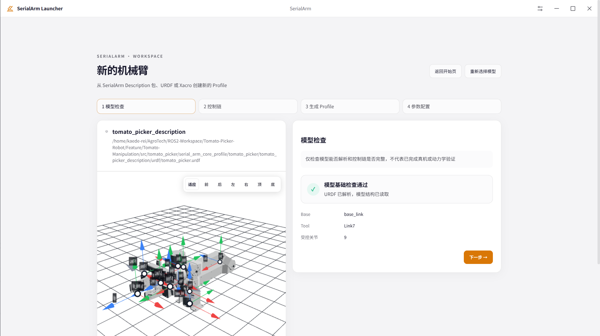
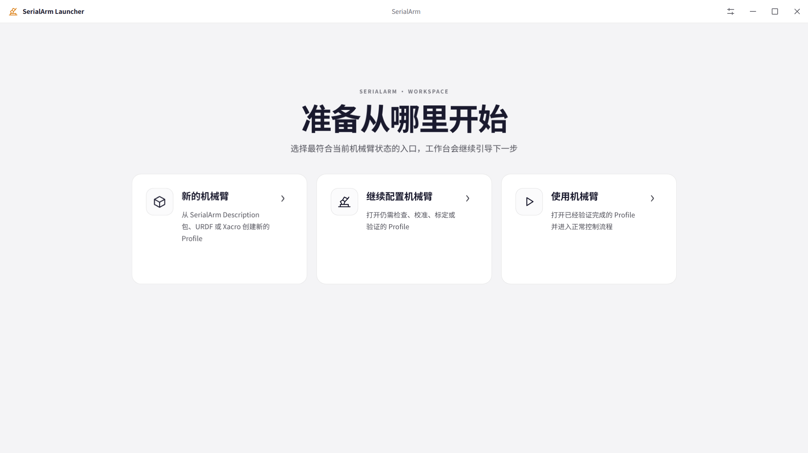
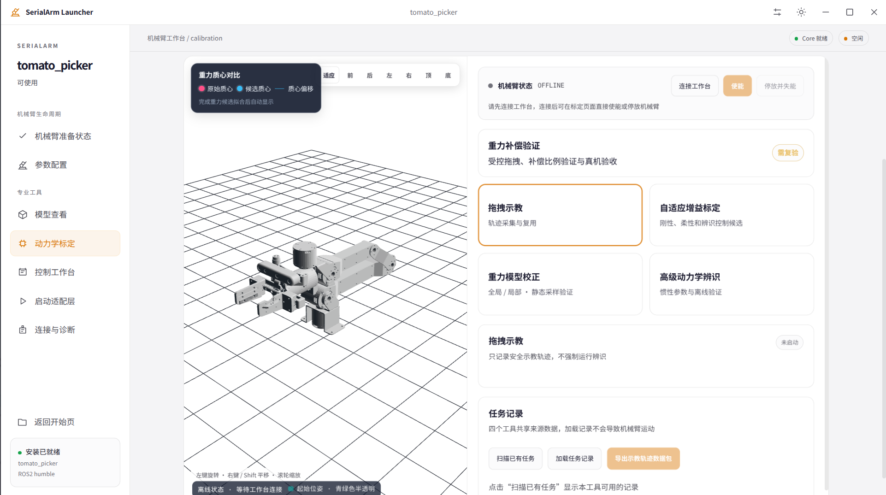
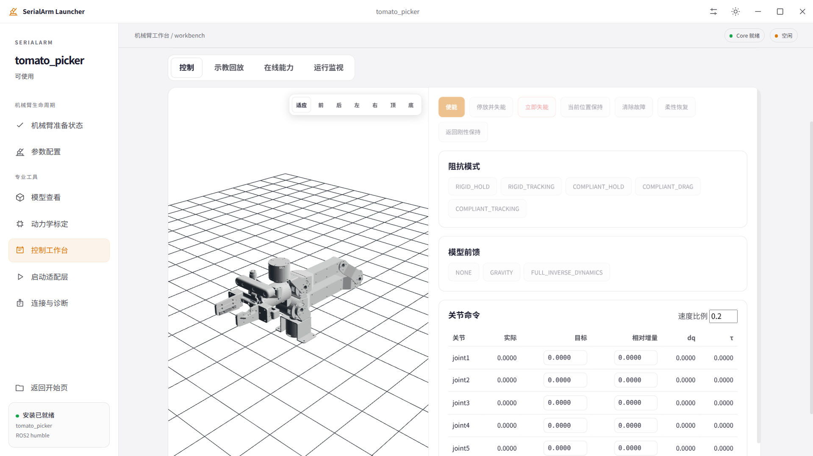
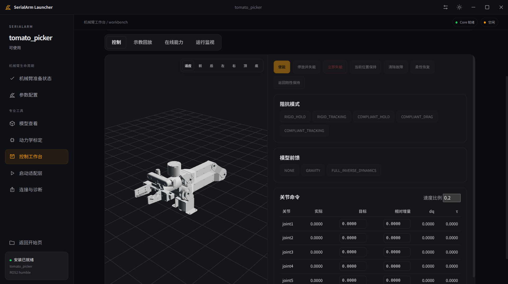
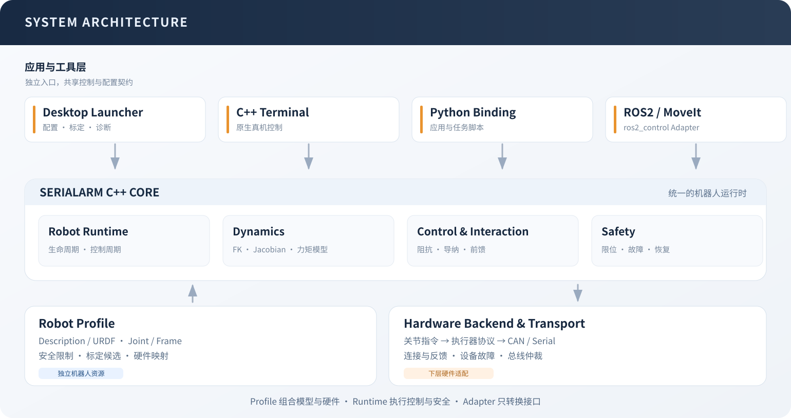
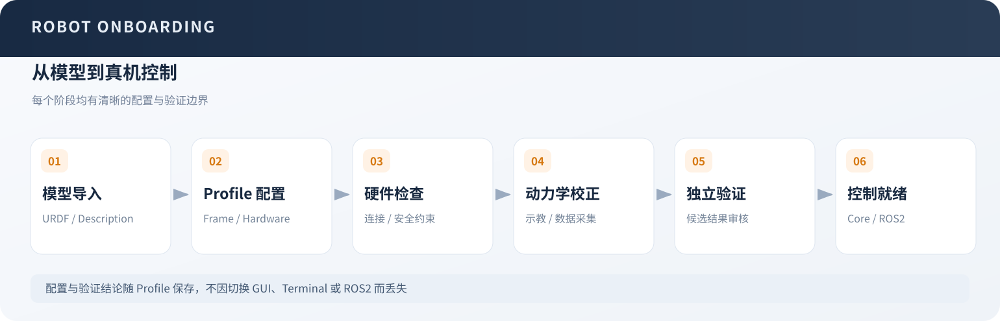

<div align="center">

# SerialArm-Core

**面向自研串联机械臂的动力学标定与控制内核**

从机器人模型与硬件接入，到动力学校正、安全控制和上层框架集成

<p>
  <a href="https://github.com/Kaede-Rei/SerialArm-Core/blob/main/LICENSE"></a>
  
  
  
  
  
</p>

[项目简介](#项目简介) · [功能与界面](#功能与界面) · [系统架构](#系统架构) · [快速开始](#快速开始) · [文档](#文档与协作) · [问题反馈](https://github.com/Kaede-Rei/SerialArm-Core/issues)

</div>

---

## 项目简介

SerialArm-Core 面向需要自行配置硬件与运动学模型的串联机械臂，将 Robot Profile、关节控制、动力学计算、模型校正和安全状态管理组织为统一的机器人运行环境

用户可以从已有 URDF 或 Description 创建机器人实例，完成硬件映射、参数配置与动力学验证，再通过 C++、Python 或 ROS2 / MoveIt 接入上层应用

图形界面与命令行共享底层 C++ Core，配置与标定结果由机器人 Profile 管理，不要求将下游机器人的专用资源合并到本仓库

<p align="center">
  
</p>
<p align="center"><sub>新机械臂接入 · 从模型导入开始建立独立机器人 Profile</sub></p>

## 功能与界面

### 从接入到标定

<table>
  <tr>
    <td width="33%" align="center"><strong>工作区入口</strong></td>
    <td width="33%" align="center"><strong>机器人配置</strong></td>
    <td width="33%" align="center"><strong>动力学标定</strong></td>
  </tr>
  <tr>
    <td></td>
    <td></td>
    <td></td>
  </tr>
  <tr>
    <td>新建机械臂、继续配置或进入已有机器人</td>
    <td>组织模型、执行器映射、控制参数与准备状态</td>
    <td>示教采集、模型校正、独立验证与候选应用</td>
  </tr>
</table>

### 明暗主题与模型预览

<table>
  <tr>
    <td width="50%" align="center"><strong>浅色主题</strong></td>
    <td width="50%" align="center"><strong>深色主题</strong></td>
  </tr>
  <tr>
    <td></td>
    <td></td>
  </tr>
</table>

### 核心能力

| 模块 | 主要能力 |
| :--- | :--- |
| 机器人接入 | Description / URDF / Xacro 导入、Profile 创建与资源管理 |
| 模型与动力学 | 正运动学、Jacobian、质量矩阵、逆动力学与重力项计算 |
| 真机控制 | 关节阻抗、关节导纳、动力学前馈、示教与轨迹回放 |
| 动力学校正 | 重力模型校正、静态采样、摩擦验证、候选与独立验证 |
| 硬件抽象 | 关节与执行器映射、Backend、CAN / Serial Transport |
| 运行安全 | 状态检查、限位、故障处理、控制准入与安全退出 |
| 上层接入 | 原生 C++、Python Binding、ROS2 ros2_control 与 MoveIt 2 |
| 桌面工作台 | Profile 配置、模型预览、控制、标定与诊断 |

## 系统架构

SerialArm-Core 将上层应用、机器人配置与硬件驱动解耦，控制和动力学能力由同一 C++ Core 提供



新机械臂从模型导入到正常使用遵循可检查的准备流程，标定候选须经验证后才能应用



## 快速开始

### 环境要求

- Linux，推荐 Ubuntu 与 ROS2 Humble 组合
- C++17、Python 3.10 及以上
- 桌面 GUI 需要 Node.js 20 及以上、npm 与图形桌面
- ROS2 / MoveIt 功能需要预先配置对应的 ROS2 环境

### 一键安装与启动

```bash
./install.sh
./launch.sh
```

安装向导可选择 C++ Core、Standalone、Python Binding、ROS2、MoveIt 或桌面 GUI 等组件，安装过程会明确显示所需系统依赖

### 在已有 ROS2 工作区构建

```bash
source /opt/ros/humble/setup.bash
colcon build
source install/setup.bash
```

在包含 `serial_arm_core` 源码的工作区根目录执行即可，Python Binding 使用仓库提供的 pybind11 构建依赖，无须提前运行独立安装脚本

### 使用内置或外部 Profile

```bash
./.install/run serial_arm_terminal --robot-profile dm_arm_gray
```

下游机械臂使用独立 Profile 文件与对应模型资源

```bash
./.install/run serial_arm_terminal \
  --robot-profile your_robot \
  --profile-file /absolute/path/to/robot_profiles.yaml
```

执行真机控制前应检查关节映射、限位、模型与执行器写入配置，确保现场具备安全停机条件

## 文档与协作

| 文档 | 内容 |
| :--- | :--- |
| [安装说明](docs/install.md) | 依赖环境、组件选择、命令行安装与运行入口 |
| [GUI 使用指南](docs/launcher.md) | 机器人工作区、模型、控制、标定与诊断 |
| [机器人接入指南](docs/tutorial.md) | Profile、硬件映射、控制与安全参数 |
| [系统架构](docs/architecture.md) | Core、Adapter、Hardware、Description 与 Profile 的职责边界 |
| [API 参考](docs/reference/api.md) | C++、Python、控制接口与扩展契约 |
| [问题反馈](https://github.com/Kaede-Rei/SerialArm-Core/issues) | 问题报告与功能建议 |

---

<div align="center">

**SerialArm-Core**

Model · Calibration · Control · Integration

</div>
