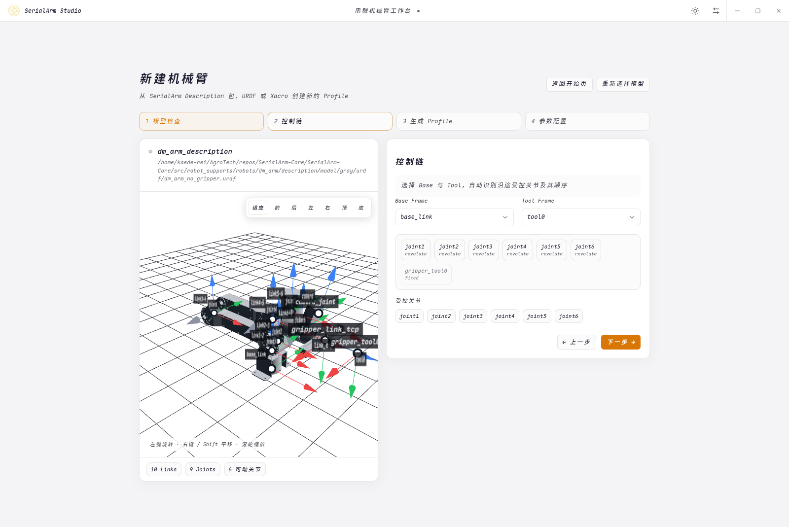
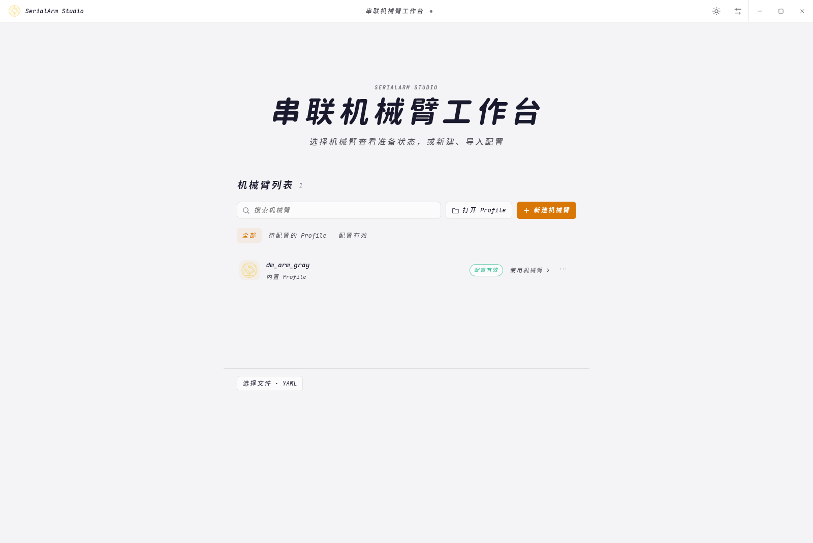
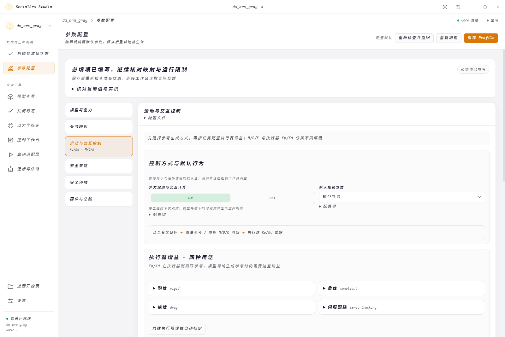
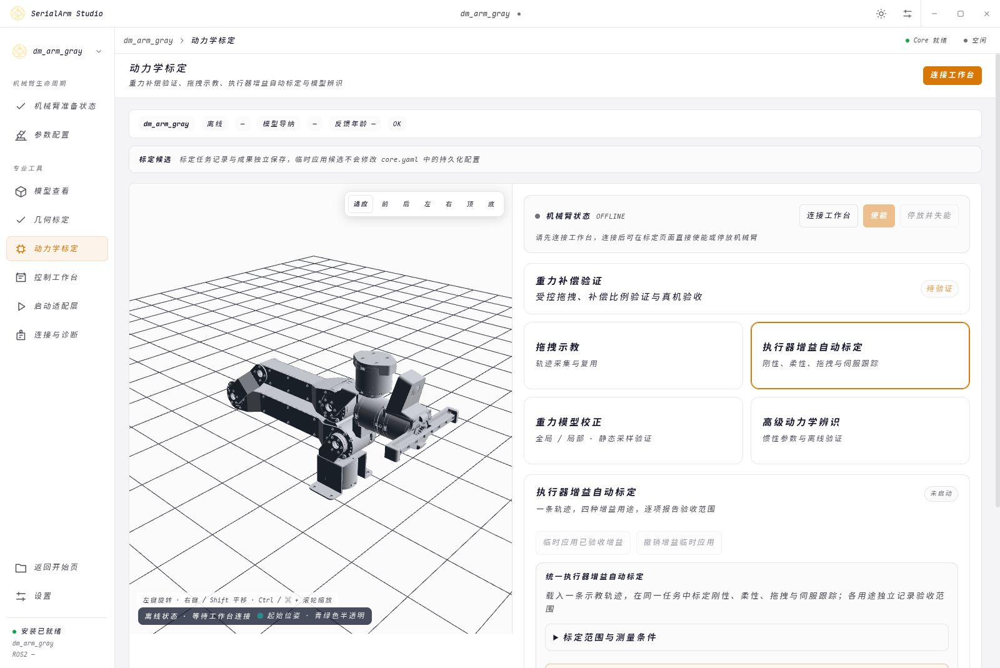
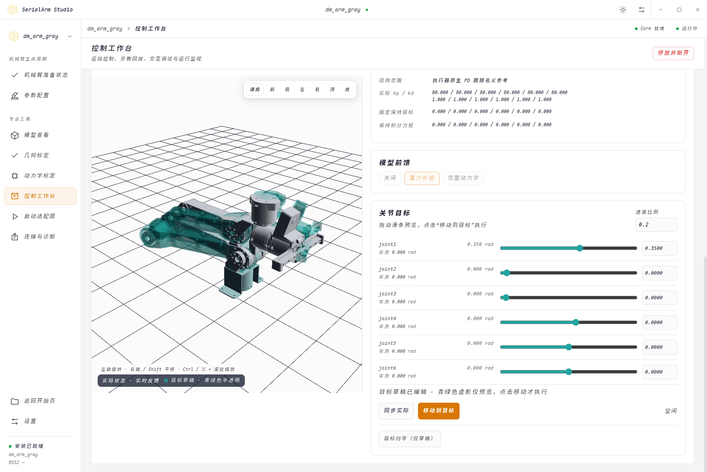
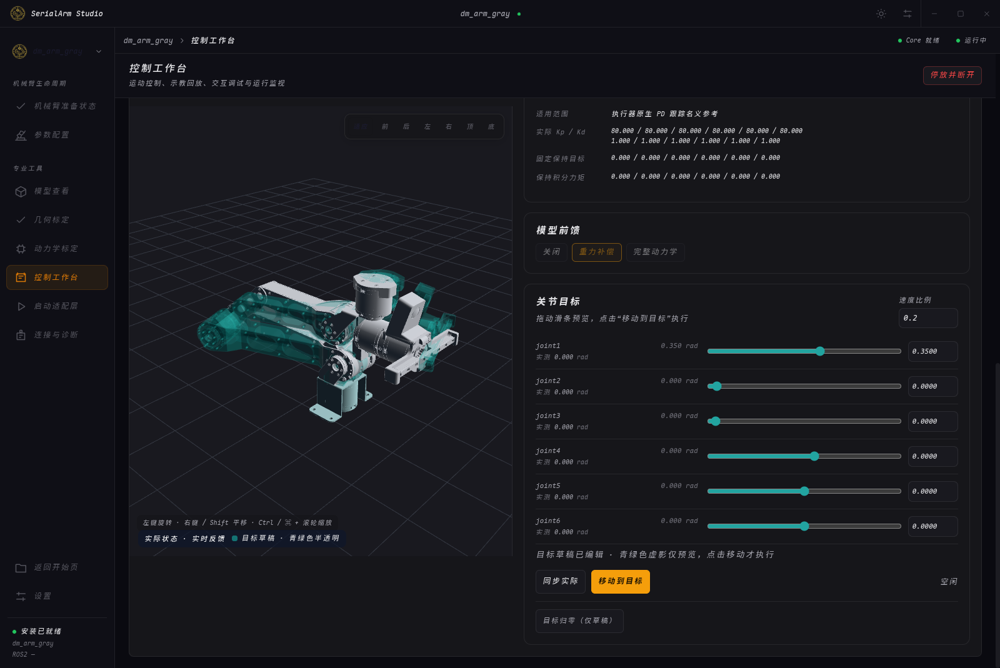
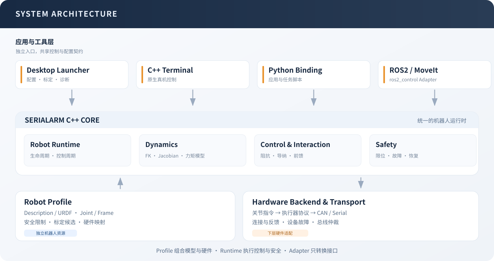
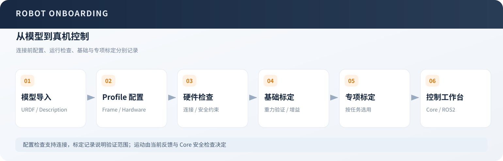

<div align="center">

# SerialArm-Core

[简体中文](README.md) · [English](README_en.md)

**A serial robot arm control core with the SerialArm Studio desktop workspace**

Configure models and drivers, calibrate dynamics and gains, and integrate robot control through C++, Python or ROS2

<p>
  <a href="LICENSE"></a>
  
  
  
  
  
</p>

[Overview](#overview) · [Features](#features) · [Architecture](#architecture) · [Quick start](#quick-start) · [Documentation](#documentation) · [Contributing](#contributing) · [License](#license) · [Issues](https://github.com/Kaede-Rei/SerialArm-Core/issues)

</div>

---

## Overview

SerialArm-Core groups the robot model, hardware mapping, dynamics and control settings in a Robot Profile; SerialArm Studio provides model inspection, configuration, control, teaching and calibration, while C++, Python and optional ROS2 / MoveIt adapters support application integration

The repository includes a Damiao motor driver and DM-Arm examples; other hardware connects through a `MotorBus` driver and Hardware YAML, with position, velocity and torque feedback plus the joint impedance command semantics required by the control chain

The desktop workspace, Terminal and Python use the C++ Core directly and run without a host ROS2 environment; downstream projects maintain their own models, drivers and calibration results through Profiles

<p align="center">
  
</p>
<p align="center"><sub>Create an independent Robot Profile from a model</sub></p>

## Features

### From configuration to calibration

<table>
  <tr>
    <td width="33%" align="center"><strong>Workspace</strong></td>
    <td width="33%" align="center"><strong>Robot configuration</strong></td>
    <td width="33%" align="center"><strong>Dynamics calibration</strong></td>
  </tr>
  <tr>
    <td></td>
    <td></td>
    <td></td>
  </tr>
  <tr>
    <td>Create a robot, continue configuration or open an existing Profile</td>
    <td>Configure the model, actuator mapping, control parameters and readiness</td>
    <td>Record demonstrations, fit models, validate and apply candidates</td>
  </tr>
</table>

### Themes and model previews

<table>
  <tr>
    <td width="50%" align="center"><strong>Light theme</strong></td>
    <td width="50%" align="center"><strong>Dark theme</strong></td>
  </tr>
  <tr>
    <td></td>
    <td></td>
  </tr>
</table>

| Area | Capabilities |
| :--- | :--- |
| Robot integration | Description / URDF / Xacro import, Profile creation and resource management |
| Models and dynamics | Forward kinematics, Jacobians, mass matrices, inverse dynamics and gravity computation |
| Hardware control | Native impedance, model admittance, dynamics feedforward, teaching and trajectory replay |
| Calibration | Automatic actuator gains, gravity correction, geometry experiments and full dynamics identification |
| Hardware abstraction | Joint-to-actuator mapping, backends, CAN and serial transports |
| Runtime checks | Feedback and state checks, limits, fault handling, command admission and parking shutdown |
| Application integration | Native C++, Python bindings, ROS2 ros2_control and MoveIt 2 |
| Desktop workspace | Profile configuration, model previews, control, calibration and diagnostics |

The control page separates reference behavior, actuator gain use and motion targets; the four gain uses are rigid, compliant, drag and servo tracking, with model admittance using servo gains to follow its virtual reference

Joint sliders and numeric inputs share one target draft; a translucent teal model previews the target, and movement starts only after confirmation; interaction tuning and teaching replay share the same control context

## Architecture

Applications, robot configuration and hardware drivers share one C++ control and dynamics core



The readiness page separates configuration, runtime checks, basic calibration, specialist calibration and inspection records; control admission depends on the current configuration, feedback and Core checks

Automatic gain calibration requires no user PD ceilings. Legacy PD limit fields remain readable and are ignored; hardware protocol bounds and gain resolution apply alongside the existing position, velocity, acceleration and torque safety limits.



The architecture and workflow figures currently use Chinese labels

## Quick start

### Desktop packages

See [Releases](https://github.com/Kaede-Rei/SerialArm-Core/releases) for packages and release notes; AppImage and deb packages target Ubuntu 22.04 x86_64, with installation steps in the [installation guide](docs/install.md#安装发行包)

The default package includes Core, Terminal, Python bindings, DM-Arm support and the GUI; running the desktop workspace requires no separate Node.js, compiler or ROS2 installation, while ROS2 / MoveIt entry points require their optional components and host environment

### Install from source

The installer requires Linux and Python 3.10+; GUI source installation also requires Node.js 20+, npm and a graphical desktop

```bash
git clone https://github.com/Kaede-Rei/SerialArm-Core.git
cd SerialArm-Core
./install.sh
./launch.sh
```

The default Standalone preset installs Core, Terminal, model tools and the GUI; select Python bindings, ROS2 and MoveIt as needed

An existing ROS2 workspace can use `colcon build`; see [installation](docs/install.md) for components, dependencies and command-line options, and [development](docs/development.md) or the [API reference](docs/reference/api.md) for C++ and Python integration

### Load a model before connecting hardware

Create a Robot Profile from URDF, Xacro or a Description package, select Base and Tool, and inspect the control chain, joint limits and model resources

With `control.runtime.write_enabled: false`, the GUI and C++ Terminal can run an offline mock session without motor models or a hardware driver

```bash
./.install/run serial_arm_terminal --config /absolute/path/to/core.yaml --machine
```

Before using hardware, select a driver, check mappings and limits, enable writing and reconnect

Use a built-in or external Profile

```bash
./.install/run serial_arm_terminal --robot-profile dm_arm_gray

./.install/run serial_arm_terminal \
  --robot-profile your_robot \
  --profile-file /absolute/path/to/robot_profiles.yaml
```

These commands require Terminal to be installed; check the device, joint directions, zero positions and limits before hardware control, and provide physical support and a local stop procedure

## Documentation

The detailed guides are currently maintained in Chinese

| Document | Contents |
| :--- | :--- |
| [Installation](docs/install.md) | Packages, source installation, optional components and graphics diagnostics |
| [User guide](docs/guide.md) | Model import, first connection, control, teaching, calibration and export |
| [Development](docs/development.md) | Architecture, source layout, builds, driver integration and packaging |
| [API reference](docs/reference/api.md) | C++, Python, control interfaces and extension contracts |
| [Calibration reference](docs/reference/calibration.md) | Data, algorithms, validation and commands for automatic gains, gravity and full dynamics identification |

## Contributing

Report bugs and discuss features through [Issues](https://github.com/Kaede-Rei/SerialArm-Core/issues), or submit a Pull Request; see [CONTRIBUTING.md](CONTRIBUTING.md) for reproduction details, scope and validation expectations

## License

Project-owned code uses [GNU GPL v3.0, GPL-3.0-only](LICENSE); third-party components retain their own licenses, including [pybind11](src/serial_arm/core/third_lib/pybind11/LICENSE) and [tl::expected](src/serial_arm/core/third_lib/tl/COPYING)

The Damiao protocol code derives from Motor SDK; its upstream source and unresolved license status are documented in the [dm_hw notice](src/robot_supports/hardware/damiao/third_lib/damiao/README.md#来源与许可)
