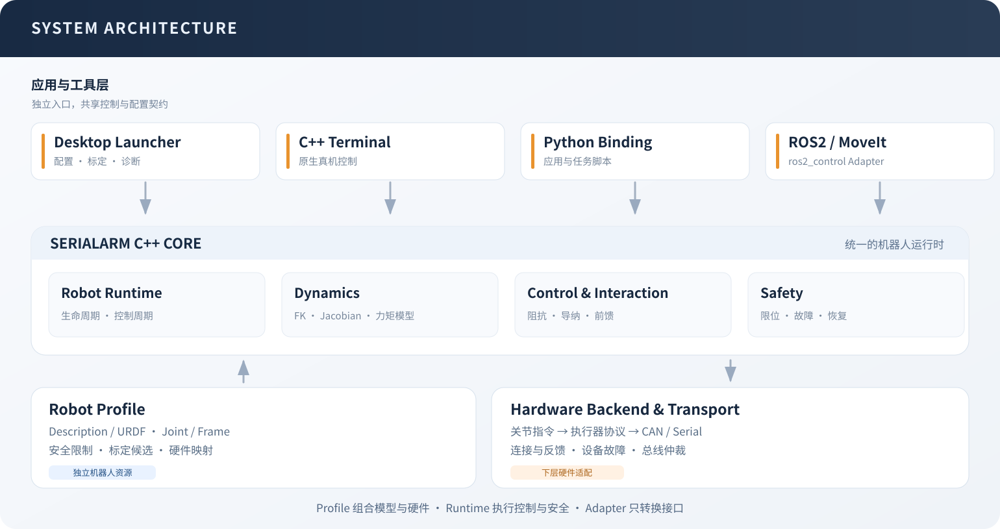

# 系统架构



SerialArm-Core 以同一 C++ Core 提供控制、动力学、交互和安全检查；GUI、Terminal 与 Python 可独立运行，ROS2 和 MoveIt 是可选适配层

## 模块职责

| 模块 | 职责 | 位置 |
| --- | --- | --- |
| Core | 生命周期、关节控制、动力学、交互、安全与标定 | `src/serial_arm/core/` |
| ControlRuntime | 周期执行、命令收取、运动来源与快照 | `src/serial_arm/core/include/serial_arm/runtime/` |
| ROS2 Adapter（可选） | 将 ros2_control 的命令、状态和生命周期接入 Core | `src/serial_arm/bringup/ros2_control/` |
| Profile | 组合模型、Core、硬件及可选 Controllers、MoveIt 资源 | `src/robot_supports/profiles/` 或下游包 |
| Hardware Backend | 将统一执行器语义转换为厂商协议 | `src/robot_supports/hardware/` |
| Protocol / Transport | 编解码、通信时间戳、共享总线与事务 | `src/robot_supports/protocol/` 与 Core transport |
| Launcher | 模型导入、配置、任务组织、可视化与进程管理 | `apps/launcher/` |

## Description 与 Profile

Description 保存模型事实：URDF/Xacro、连杆与关节、网格、惯性、限位、固定坐标系及 ros2_control 模型资源

Profile 保存这台机械臂的使用配置：受控关节顺序、Base/Tool Frame、驱动、执行器映射、总线、方向、比例、零位、增益、安全限制、停放目标、标定参数和上层资源引用

Profile 引用可解析的 Description；下游机械臂可以在自己的项目中维护两者

Profile Library 只管理这些引用，移除列表项保留磁盘文件；同名 Profile 通过独立列表标识区分

## 配置与连接

导入 Description 后，用户选择 Base 与 Tool，工作台推导连续串联链；固定关节留在模型中，非固定且非 mimic 的链上关节进入 Core 的 `joint_names`

旁支夹爪和其他机构保留在模型中，需要单独的驱动与状态接口

新 Profile 默认关闭执行器写入、摩擦补偿和导纳，方向、比例、零位与增益为接入初值；实际映射、停放路径和参数由对应机械臂检查后使用

机械臂准备页面分别组织

| 信息 | 来源与用途 |
| --- | --- |
| 连接前配置 | 资源解析及配置检查，指出可修正的文件和字段 |
| 运行检查 | 连接后的反馈、执行器状态与故障 |
| 基础标定 | 重力补偿验证与执行器增益自动标定，按此顺序建立基础参数 |
| 专项标定 | 重力模型校正、高级动力学辨识与几何标定 |
| 检查记录 | 人工观察与验证结果，随来源指纹保存 |

人工自查不授予控制权限，也不阻止合法配置运行；连接、使能与每次命令由资源、硬件反馈、生命周期和 Core 安全检查共同约束

文件或参数变化后，原记录的来源与当前配置分别显示，需在对应范围重新核对

## 控制方式、用途与任务

三者分别决定参考如何生成、执行器用哪组增益、机器人正在做什么

| 维度 | 值 | 作用 |
| --- | --- | --- |
| 控制方式 `ReferenceBehavior` | 原生阻抗、模型导纳 | 选择直接执行名义参考或根据外力生成虚拟参考 |
| 增益用途 `JointGainProfile` | 刚性、柔性、拖拽、伺服跟踪 | 选择关节侧 Kp/Kd |
| 任务 `JointImpedanceMode` | 保持、跟踪、拖拽对应的兼容枚举 | 管理目标、连续命令与拖拽行为 |

刚性和柔性分别保留保持、跟踪参数，拖拽使用低刚度阻尼参数，伺服跟踪为辨识和导纳共用的执行增益

`control.runtime.tracking_gain_profile` 设置默认跟踪用途，支持 `RIGID`、`COMPLIANT`、`SERVO_TRACKING`；省略时从旧 `tracking_impedance_mode` 推导

模型导纳的保持与跟踪统一使用伺服增益，交互特性由 M/D/K 决定；GUI 和 C++ Terminal 的普通示教临时使用原生阻抗与重力补偿，结束后恢复原上下文

Python 交互终端要求用户先停放失能、显式选择原生阻抗与重力补偿，再使能拖拽，结束后按需要显式切回原控制方式

旧任务枚举和 `identification_tracking` 配置仍兼容，标准配置与新候选使用 `servo_tracking`

## 一次控制周期

```text
上层目标
  → 名义参考及速度/加速度约束
  → 原生阻抗直接执行，或模型导纳生成虚拟参考
  → 动力学前馈、执行器增益和模式交接
  → 位置、速度、加速度与 PD+前馈总力矩约束
  → Safety 检查
  → Joint/Actuator 映射
  → Backend 写入
```

Terminal、Python Session 和 ROS2 Adapter 共享 `ControlRuntime` 的执行与快照契约；调用方负责提交命令，不能并发驱动同一个 Robot

ROS2 从 Core 配置读取默认任务与增益用途；停止、故障恢复和停放按各自生命周期执行

Core 与桌面启动直接组装原生库、Python 与资源搜索路径，不 source 宿主 ROS2；只有显式启动适配入口时才加载 ROS2 发行版和适配工作区，缺少适配组件不影响原生功能

点到点命令分配独立运动编号；参考生成结束后，使用新鲜反馈检查逐关节位置、速度和连续稳定时间，向上层报告执行中、完成、中断或失败，滑条目标与命令接收状态不用于推测到位

### 原生阻抗

执行器按关节位置、速度误差及前馈执行 MIT 命令

```text
tau = Kp * (q_ref - q) + Kd * (dq_ref - dq) + tau_ff
```

前馈可选择关闭、重力或完整逆动力学；保持、跟踪和拖拽使用对应用途的增益

### 模型导纳

观测器估计外力矩，虚拟模型生成相对名义目标的退让

```text
M_v * delta_q_ddot + D_v * delta_q_dot + K_v * delta_q = tau_ext_hat
q_virtual = q_nominal + delta_q
```

内层伺服跟随虚拟参考，前馈使用实测状态下的质量矩阵、科氏项和重力，结合虚拟参考加速度及外力估计计算；最终参考仍受总力矩预算约束

虚拟模型用后向 Euler 离散积分，限制后的接受状态回写积分器；运行中同策略调参按控制周期过渡

M 必须为正，D、K 可为零；K 为零时没有弹簧回位；控制方式在失能时切换

### 反馈与外力观测

Backend 将接收时间与连续性随帧传入 Core，反馈年龄取接收时间，观测器只在有效的新测量上推进

`MOMENTUM` 使用动量观测；`FULL_ID` 使用完整逆动力学残差，额外要求有效实测加速度；无效值与过期反馈分别标记

观测器零偏、摩擦残差和死区用于外力估计；残差零偏不加入执行器动力学前馈

## 保持、受扰与回位

普通保持交接默认保留名义目标 `PRESERVE_NOMINAL`，显式“当前位置保持”使用 `CAPTURE_MEASURED`；导纳偏移与原名义目标分别保存

`control.hold_compensation` 是原生刚性保持的有界积分补偿，低速、小误差且观测器有效时工作；接触、限幅、模式变化与故障按条件冻结或清理，模型导纳和柔性保持不使用它

轨迹误差比较最终参考与实际位置，名义目标与虚拟退让另行记录；回位验证同时检查原目标保持、关节误差和独立外部测量

## 标定与候选

执行器增益自动标定分别验证四种用途，保持与跟踪独立记分；伺服候选同时通过原生跟踪和模型导纳跟踪

候选携带采样姿态范围、负载、响应估计、验证指标及保持补偿状态；局部无接触试验给出的范围用于后续调参，接触和末端精度由对应实测验证

在线结果与离线每轮辨识分别保存候选，预览、写入配置和导出绑定明确的来源与轮次；存在离线候选时不会默认采用在线旧结果

在线静态重力候选固定质量并校正一阶矩，离线静态候选可以同时更新质量与一阶矩；重力覆盖只将这些参数用于重力计算，完整惯性部署通过 URDF 导出与对应验证

几何 TCP 候选先比较新 Frame 与工具偏移，再导出独立的 URDF、Core 与 Profile；确认采用时登记新 Profile，保留原模型与原配置

重力覆盖只替换重力项；导出 URDF 的质量或质心变化会影响完整动力学，需在对应工况重新验证

离线重算读取保存的源快照、训练与留出数据；局部辨识从构造系统开始固定可信连杆，未观测方向保留先验；完整方法见 [静态重力](reference/offline-gravity.md) 与 [完整动力学](reference/dynamic-identification.md)

## 工作台与持久化

控制页集中管理生命周期、控制方式、增益用途与目标；示教回放管理轨迹；交互调试管理会话参数与响应记录；运行监视只读展示链路

关节滑条与数值框共享一个目标草稿，青绿色虚影预览目标；只有发送动作会启动运动

| 参数来源 | 生命周期 |
| --- | --- |
| Profile 默认 | 从对应配置文件加载，显式保存后持久化 |
| 连接覆盖 | 本次连接，保留原文件 |
| 会话调参 | 当前工作台，保存需预览差异与确认 |
| 标定或停放临时参数 | 对应任务，结束或故障按任务契约恢复 |

保存核对目标文件和来源指纹，保留备份并原子替换；历史任务与候选使用自己的源快照，导出不读取另一台在线机械臂的临时参数

历史任务按机器人和工具筛选后分页，普通轨迹选择、重命名及记录导出可离线操作；已保存记录的导出不要求断开工作台，耗时导出在后台执行，保持与失能命令继续使用控制通道

子页切换保留模型和相机；URDF 内容、路径或受控链变化时以模型身份失效缓存，重新加载模型与限位

## 硬件与资源边界

Renderer 无 Node 权限，Electron 主进程只提供允许的文件选择与 IPC，Python 负责配置、路径、文件和离线任务，C++ 负责硬件生命周期与控制安全

诊断、Description 导入和候选预览不打开执行器；运动需要明确的硬件连接与当前 Core 检查

GUI 按设备路径独占连接；直接使用底层入口需自行保证设备独占

停放失败保留连接，强制结束仅停止进程，现场应确认执行器状态

## 外部机械臂示例

`tomato_picker` 可从 Description 导入或直接加载外部 `robot_profiles.yaml`；模型中 `base_link → tool0` 对应的 joint1 到 joint6 作为主链，夹爪由自己的驱动提供状态

外部资源构建和加载后，使用与内置机械臂相同的配置检查、控制、标定与导出入口

GUI 的 Three.js 展示属于可视化；交互式 Terminal、Python 和离线 CLI 使用相同的 Core 数据与任务结果
