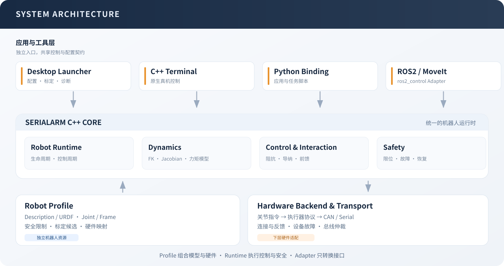

# 架构与开发

SerialArm-Core 由 C++ Core 执行控制、动力学、交互和安全检查；GUI、Terminal 与 Python 共用原生能力，ROS2 和 MoveIt 通过可选适配层接入



## 组件与边界

| 组件 | 职责 | 源码 |
| --- | --- | --- |
| Core | 生命周期、关节控制、动力学、安全与标定 | `src/serial_arm/core/` |
| ControlRuntime | 周期执行、命令收取、运动来源与快照 | `src/serial_arm/core/include/serial_arm/runtime/` |
| Launcher | 配置、任务、可视化与进程管理 | `apps/launcher/` |
| ROS2 Adapter | ros2_control 命令、状态与生命周期适配 | `src/serial_arm/bringup/ros2_control/` |
| Description / Profile | 模型资源与机械臂使用配置 | `src/robot_supports/` 或下游项目 |
| Hardware Backend | 将统一执行器语义转换为厂商协议 | `src/robot_supports/hardware/` |
| Protocol / Transport | 编解码、时间戳、共享总线与事务 | `src/robot_supports/protocol/` 与 Core transport |

Core 通过 `MotorBus` 接口连接硬件，达妙是现有内置驱动；新增执行器由匹配的 Backend 实现协议、反馈与控制语义

Description 保存 URDF/Xacro、网格、惯性、限位和坐标系；Profile 引用 Description，并配置受控链、Base/Tool、映射、总线、增益、安全限制、停放和可选上层资源

Base 到 Tool 之间非固定、非 mimic 的关节按链顺序进入 `joint_names`；旁支夹爪保留在模型中，由对应驱动提供状态

Renderer 无 Node 权限，Electron 主进程提供受限文件与 IPC 入口，Python 管理配置和离线任务，C++ 管理硬件生命周期与控制安全；诊断、模型导入和候选预览不打开执行器

GUI 按设备路径独占连接；直接使用底层入口的调用方负责保证设备独占

## 控制数据流

```text
上层目标
  → 名义参考及速度/加速度约束
  → 原生阻抗直接执行，或模型导纳生成虚拟参考
  → 动力学前馈、执行器增益与模式交接
  → 位置、速度、加速度与 PD+前馈总力矩约束
  → Safety 检查
  → Joint/Actuator 映射
  → Backend 写入
```

Terminal、Python Session 和 ROS2 Adapter 共享 `ControlRuntime` 的执行与快照接口；同一个 Robot 由一个控制循环驱动

| 维度 | 类型 | 作用 |
| --- | --- | --- |
| 控制方式 | `ReferenceBehavior` | 原生阻抗或模型导纳，决定参考如何生成 |
| 增益用途 | `JointGainProfile` | 刚性、柔性、拖拽、伺服跟踪，决定关节侧 Kp/Kd |
| 任务 | `JointImpedanceMode` | 保持、跟踪与拖拽，管理目标和连续命令 |

四用途配置写入 `control.controller.rigid`、`compliant`、`drag`、`servo_tracking`，`allow_full_cmd` 与它们同级；刚性与柔性各含 `hold`、`tracking` 两套参数，内部六组参数与原任务枚举保留兼容

`control.runtime.tracking_gain_profile` 支持 `RIGID`、`COMPLIANT`、`SERVO_TRACKING`；省略时从旧 `tracking_impedance_mode` 推导；旧平铺增益与 `identification_tracking` 兼容读取，重复字段冲突时拒绝，新建、保存和导出统一写四用途结构

### 原生阻抗与模型导纳

原生阻抗输出位置、速度、前馈力矩、Kp、Kd，由 Backend 实现执行器命令；内置达妙驱动使用 MIT 模式

```text
tau = Kp * (q_ref - q) + Kd * (dq_ref - dq) + tau_ff
```

前馈可选择关闭、重力或完整逆动力学；模型导纳使用外力矩估计生成相对名义目标的退让，内层伺服跟随虚拟参考

```text
M_v * delta_q_ddot + D_v * delta_q_dot + K_v * delta_q = tau_ext_hat
q_virtual = q_nominal + delta_q
```

虚拟模型使用后向 Euler 积分，将限幅后的接受状态回写积分器；M 必须为正，D、K 可为零，K 为零时无弹簧回位；运行中同策略调参按控制周期过渡，控制方式在失能时切换

导纳前馈结合实测状态下的质量矩阵、科氏项、重力、虚拟参考加速度及外力估计计算，最终参考仍受总力矩预算约束；模型导纳的保持和跟踪统一使用伺服增益，交互特性由 M/D/K 决定

### 反馈、保持与完成状态

Backend 随帧传入接收时间和连续性，观测器只在有效新测量上推进；`MOMENTUM` 使用动量观测，`FULL_ID` 使用完整逆动力学残差并要求有效实测加速度；零偏、摩擦残差和死区用于外力估计，残差零偏不加入动力学前馈

普通保持交接使用 `PRESERVE_NOMINAL` 保留原目标，显式“当前位置刚性保持”使用 `CAPTURE_MEASURED`；导纳偏移与名义目标分别保存

`control.hold_compensation` 是原生刚性保持的有界积分补偿，在低速、小误差且观测器有效时工作；接触、限幅、模式变化和故障按条件冻结或清理，模型导纳与柔性保持不使用它

点到点命令具有独立运动编号；参考结束后以新鲜反馈检查逐关节位置、速度与连续稳定时间，报告执行中、完成、中断或失败；目标草稿与命令接收不表示已经到位

## 配置与结果

| 来源 | 生命周期 |
| --- | --- |
| Profile 默认 | 显式保存后持久化 |
| 连接覆盖 | 本次连接，保留原文件 |
| 会话调参 | 当前工作台，保存前预览差异并确认 |
| 标定或停放临时参数 | 对应任务，结束或故障时按任务恢复 |

新 Profile 默认关闭执行器写入、摩擦补偿和导纳；`write_enabled=false` 的 GUI 与 Terminal 使用 Core 和 URDF 建立 mock，不加载硬件插件；实机会话检查当前资源、硬件反馈、生命周期与 Safety 限制

保存核对目标文件和来源，保留备份并原子替换；人工检查记录携带来源，配置变化后需要重新核对对应范围

历史任务和候选保留源快照，应用核对当前控制上下文，导出按兼容性选择当前配置或任务源快照；`available` 表示测量可用，`validated` 表示参考指标达标，未达指标以警告展示，未完成测量的用途不可用

重力覆盖只替换重力项；URDF 质量与质心变化会影响完整动力学，需在相应工况验证；静态和完整惯性辨识的数据、算法及导出条件见 [标定参考](reference/calibration.md)

几何 TCP 候选导出独立 URDF、Core 与 Profile；重标定已有 TCP 时更新候选自有固定关节，并将测量转换回其父坐标系，确认采用后登记新 Profile

子页切换保留模型与相机；URDF 内容、路径或受控链变化时重新加载模型和限位；记录浏览与普通导出可离线操作，耗时导出使用后台任务，保持与失能命令继续使用控制通道

## 准备开发环境

按修改范围选择组件，安装选项见 [安装](install.md)

```bash
# Core、Terminal、Python Binding 和 GUI，不依赖 ROS2
./install.sh --preset standalone --with-python --jobs 1 --yes

# 完整组件，包括 ROS2 / MoveIt；需先安装 ROS2
./install.sh --preset dev --jobs 1 --yes
```

安装器使用 CMake 3.20+、C++17、Pinocchio、Eigen3 和 yaml-cpp；Python Binding 使用 Python 3.10+ 和仓库内置 pybind11，GUI 使用 Node.js 20+ 和 npm

`.install/setup.bash` 与 `.install/run` 加载原生环境；只有显式执行 `./.install/run ros2 ...` 或加载 `.install/ros2-setup.bash` 才进入 ROS2 适配环境

## 手动构建

需要自定义安装前缀或单独构建 C++ 组件时，在仓库根目录使用独立构建脚本

```bash
# Core 库、Terminal 和模型工具，不构建 Python Binding 或 GUI
JOBS=1 ./tools/bootstrap_standalone.sh
source install/standalone/setup.bash

# 同时安装达妙驱动、DM-Arm Profile 和模型资源
JOBS=1 ./tools/bootstrap_standalone.sh --robot dm_arm

# 仅构建 Core 库，不构建 Terminal 与模型工具
JOBS=1 ./tools/bootstrap_standalone.sh --without-terminal
```

该脚本优先使用系统 CMake 包；依赖不齐时需提供 Conan 2，缺少二进制包时默认不编译依赖源码；如需允许该回退，显式设置 `SERIAL_ARM_ALLOW_SOURCE_BUILD=1`

默认构建目录为 `build/serial_arm_core`，安装目录为 `install/standalone`；可通过 `CORE_BUILD_DIR`、`INSTALL_PREFIX`、`BUILD_TYPE` 和 `JOBS` 调整

ROS2 工作区构建见 [安装](install.md#直接在-ros2-工作区构建)；GUI 由统一安装器的 `--gui-only` 入口单独准备

## C++ 下游集成

安装后通过 `find_package(serial_arm_core CONFIG REQUIRED)` 导入；按用途链接以下目标

| CMake Target | 用途 |
| --- | --- |
| `serial_arm::core` | 状态、映射、控制器和 Safety 等基础接口 |
| `serial_arm::config` | Core 配置与 Profile 读取 |
| `serial_arm::robot` | 机器人控制流程与硬件装载 |
| `serial_arm::dynamics` | 动力学模型计算与重力校正 |
| `serial_arm::interaction` | 外力观测与模型导纳 |

下游构建时将安装前缀加入 `CMAKE_PREFIX_PATH`，同时保证 Pinocchio、Eigen3 和 yaml-cpp 的 CMake 包可被找到；接口说明见 [API 参考](reference/api.md)

## 检查改动

编译所改组件后，在仓库根目录执行对应检查；以下命令不连接机械臂

```bash
# GUI 资源、图形运行库与 IPC 路由静态检查，需先安装 GUI 依赖
node apps/launcher/scripts/verify.cjs

# Python 数组、快照类型和 NumPy 内存布局，需已安装 Python Binding
./.install/run python tools/check_python_binding.py

# 原生命令入口
./.install/run serial_arm_terminal --help
./.install/run serial_arm_model_probe --help
./.install/run serial_arm_model_calibrator --help
```

GUI 改动还需启动 `./launch.sh` 检查受影响页面、语言与主题；三维改动需验证模型实际绘制与交互，静态资源检查不能代替渲染验证

控制逻辑改动先检查配置、离线记录与数值结果，再按实际改动验证实机行为；贡献说明应区分离线验证与实机验证，记录使用的硬件、配置和未覆盖的路径

## 构建发行包

准备 Release 时执行 `./build_linux.sh`，默认生成独立 Core、Python 与 GUI 发行包；使用 `--with-ros2` 才附加 ROS2 / MoveIt 适配层，构建条件和产物见 [安装](install.md#构建-linux-发行包)

日常更新按修改范围构建和检查组件，无需重新生成 AppImage 或 deb

## 文档约定

README 提供项目介绍、安装和文档入口，操作说明集中在 [使用指南](guide.md)，算法与接口细节放在 `docs/reference/`

命令应写明执行目录、所需组件与参数含义；模型、设备和资源路径使用示例值，不写入本机绝对路径、运行记录或私人笔记

修改公开行为、配置格式或命令入口时，同步更新对应说明；自然语言不使用中文句号，段末不加标点，代码、路径、URL、数学表达与许可证原文保留必要符号
