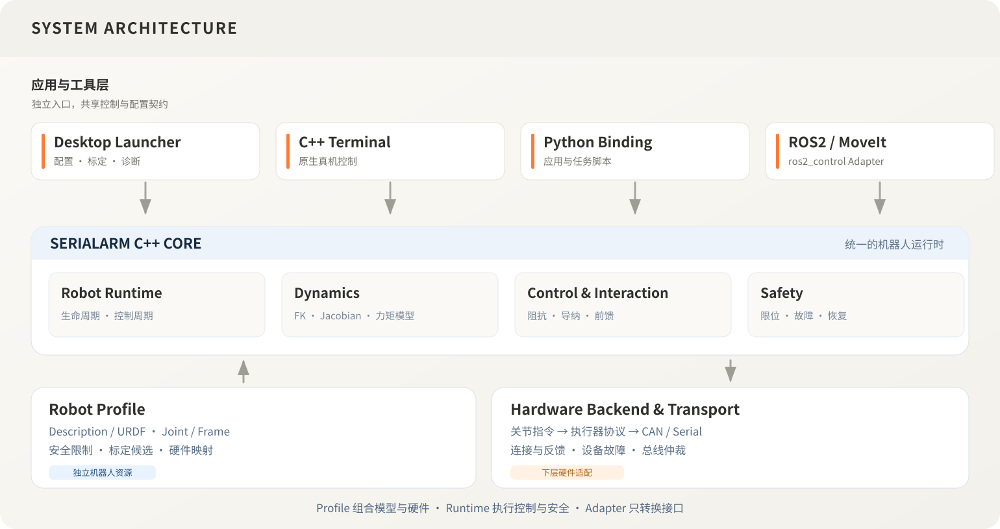

# 架构与开发

SerialArm-Core 使用 C++17，Core 负责硬件生命周期、控制、动力学、交互与安全；Terminal、Python、GUI 和 ROS2 复用同一原生实现



## 组件边界

| 组件 | 职责 | 源码 |
| --- | --- | --- |
| Core | Robot、控制、动力学、安全与标定 | `src/serial_arm/core/` |
| ControlRuntime | 周期执行、运动来源和状态快照 | `src/serial_arm/core/include/serial_arm/runtime/` |
| Launcher | 配置、任务、可视化与进程管理 | `apps/launcher/` |
| ROS2 Adapter | ros2_control 命令、状态与生命周期 | `src/serial_arm/bringup/ros2_control/` |
| Description / Profile | 模型资源、受控链、硬件映射与策略 | `src/robot_supports/` 或下游项目 |
| Hardware Backend | 单位、反馈与执行器协议适配 | `src/robot_supports/hardware/` |
| Protocol / Transport | 编解码、接收时间、共享总线和事务 | `src/robot_supports/protocol/` 与 Core transport |

Description 保存几何、惯性、限位和坐标系；Profile 引用资源并定义受控关节顺序、Base/Tool、映射、执行路径及安全策略；Base 到 Tool 之间非固定、非 mimic 关节按链顺序进入 `joint_names`

配置与 API 使用 SI，旋转关节使用 rad、rad/s、N·m，直线关节使用 m、m/s、N；关节类型由模型决定，Backend 将厂商编码量转换到统一执行器契约

Renderer 无 Node 权限；Electron 提供受限文件与 IPC，Python 处理配置和离线任务，C++ 串行处理硬件控制；普通诊断和模型预览不连接硬件，显式连接观察不使能机械臂

## 工作台视觉与交互

工作台保留 Proof 的暖白浅色与暖灰深色，以微信绿 `#07C160` 和白字表达实心主操作；警告采用亮橙红 `#FF8A3D`，错误采用鲜红 `#FF454F`，小字使用对应的可读前景色；字体为真实 Maple Mono CN Italic；主题值与语义映射集中在 `apps/launcher/renderer/styles.css`，Kudu Calm Control 的 Token 结构来源与许可见 `packaging/linux/licenses/kudu.txt`；组件消费 `brand-*`、surface、状态与 `viz-*` Token，旧 `primary` 等名称作为现有组件别名

控制与回放在宽窗采用 360px 模型对照和任务并列布局；运行监视、响应整定及增益标定使用全宽任务；工作区实际宽度不超过 880px 时，先显示任务主操作，模型默认折叠并放在主操作之后；用户展开状态按 Profile、任务与宽窄布局保留；折叠会暂停三维绘制与目标叠影请求，展开复用原渲染器、几何资源和相机状态；执行前仍需完成实际目标预览；子页面导航置于模型与任务上方，机器人控制保持可达，质心对照工具位于画布外的正常页面流

参数页采用紧凑保存栏、常驻检查摘要和可折叠完整核对，窄窗使用分组选择器；模型页对象树宽 224px，窄窗属性移到预览下方，关节预览使用页面滚动；设置页按外观、语言与三维渲染纵向分区

准备状态保留全宽阶段流程；诊断以实时执行器表格为主，连接覆盖与安装说明按需展开；各窗口宽度均保持条件提示、保持与恢复、使能和失能操作可达

实测、目标、估计、参考分别使用蓝、棕金、青绿、紫色，并用实线、长虚线、点划线、短虚线区分；Reference 与验证通过的 Success 独立；XYZ、关节轴、COM 的工程色不随品牌变化；主题切换就地更新画布、网格与现有材质，保留模型实例、相机、输入、焦点和页面上下文；折叠与子页切换沿用现有连续动效，尊重减少动态偏好

## 生命周期与首次接入

```text
configure → INACTIVE
             ├─ connect → observe → 读取实际反馈，不使能
             └─ activate → 验证反馈与当前位首命令 → ACTIVE
ACTIVE → deactivate → INACTIVE
ACTIVE → FAULT → 保持或停止输出 → 显式恢复或失能
```

`Robot::connect()` 刷新实际能力和 Safety 交集；`observe()` 保留越界、离线和驱动错误供诊断，不能据此声称已具备运动条件；`activate()` 在使能前检查真实反馈和完整当前位命令，再交给 Backend

MIT 首次保持需要明确的正 Kp/Kd，模型初值是待测设计值；CSP 位置控制不需要 MIT 增益或 MDK，仅由驱动位置环执行名义参考；几何、轴身份、映射和最低运动边界必须在第一次运动写入前核对

Backend 的 `activate(initial_cmd)` 在逐轴使能后立即发布当前位首命令；达妙 MIT 使用已验证预算内的 PD 与前馈，CSP 使用位置和速度上限；纯连接观察的 cleanup 不发失能命令；插件随当前 Core ABI 重新构建

Terminal 停放在 MIT/CSP 下统一使用受限 RIGID 轨迹，满足严格位置、速度和持续稳定判据后才失能；失败保持使能并报告原因；`Robot::deactivate()`、Python `stop()` 和上下文退出不执行停放轨迹

显式停放不读取自动退出开关；桌面正常退出由 Bridge 检查当前路径、会话指纹和 scoped 停放验收后调用停放，成功失能后才释放连接；Terminal 要求退出前已失能，ROS2 `on_deactivate()` 直接停用，不触发停放运动

参数编辑器的范围提示与保存校验共用 `parameter_contract.py`；原生配置加载最终校验模型、映射和硬件边界；关系约束包括 `state_vel_scale >= cmd_vel_scale` 和 `max_dt_s >= 1 / ctrl_frequency_hz`

位置内缩量、摩擦过渡速度、保持门限和停放容差使用逐轴向量，YAML 使用 joint name 映射；故障静止门限和响应验收门限分别归属 Safety 与 Admittance Validation；未启用自动停放时允许空停放动作，显式执行前检查动作完整性

## 控制与观测

| 维度 | 类型 | 含义 |
| --- | --- | --- |
| 执行路径 | `ControlPath` | MIT 或 CSP，在 INACTIVE 切换 |
| 交互模式 | `JointImpedanceMode` | RIGID、COMPLIANT、DRAG、SERVO_TRACKING |
| 增益来源 | `GainSource` | 配置、任务覆盖或交接中 |
| 运动来源 | `MotionSource` | 点目标、连续参考、回放、标定或停放 |

MIT 发送 q、dq、Kp、Kd 和前馈，由执行器计算 PD；CSP 发送周期位置及速度上限，柔性与拖拽通过外层 MDK 修正参考；伺服跟踪暂时复用刚性行为

```text
名义参考与运动约束
  → MIT 直接参考，或 CSP 导纳虚拟参考
  → 力矩预算与参考约束
  → Safety → 关节/执行器映射 → Backend
```

MIT 的三组 PD 配置为 `control.controller.rigid`、`compliant`、`drag`；拖拽 Kp=0，保持重力补偿和现有拖拽阻尼；CSP 的 M/D/K 是虚拟模型参数，与 MIT Kp/Kd 分开

导纳使用后向 Euler，限幅后的接受状态回写积分器；无外力时的持续偏置会在 K=0 拖拽中变成持续运动，MDK 不能修正上游残差来源

CSP 正常柔性与拖拽要求 `capability.admittance.validation` 中观测与响应均已验证；首次响应测试通过 `set_admittance_validation(true)` 在外力观测已验证且 K>0 时开放有限柔性，退出回到当前位 RIGID；该测试许可不自动生成验收结论

改动观测参数会撤销观测与响应验证，改动 MDK 或退让边界会撤销响应验证；失去准入条件时停止沿用导纳模式；MIT 拖拽和故障拖拽依赖当前模型及负载的重力验证，CSP 普通与故障拖拽依赖观测和响应验证，不要求 MIT 重力补偿标志

反馈接收时间使用 `steady_clock`；有效新测量对齐后再推进观测器；低速速度量化在关节侧用短位置窗处理，同一状态用于动力学、动量和摩擦标定；主机接收时间不是电机物理采样时间

`PRESERVE_NOMINAL` 保留原名义目标，`CAPTURE_MEASURED` 捕获实测位置；退出 DRAG 捕获当前位并取消旧运动来源；点目标的参考结束、稳定和实际到位分别由运动快照报告

## 执行与持久化

同一 Robot 只允许一个周期所有者；Terminal、Python Session 和 ROS2 复用 `ControlRuntime`，模式、参考和模型更新必须与周期串行；不要再开第二个写总线循环

`RuntimeSnapshot.cycle` 为实际控制周期，`observation` 为 INACTIVE 观察，`fault_feedback` 为故障反馈；只有控制周期参与示教、标定和普通运动完成判断

| 数据 | 生命周期 |
| --- | --- |
| Profile 参数 | 显式保存后持久化，写入前预览差异 |
| 连接覆盖 | 当前连接，不改原文件 |
| 会话调参 | 当前进程，保存后才成为默认 |
| 标定临时参数 | 对应任务，退出时恢复 |
| 检查和验收记录 | 绑定模型、映射、路径和相关参数；依赖变化后只撤销受影响范围 |

配置完整、人工检查、实测验收和当前连接状态分别显示；离线或重启不删除历史证据，也不沿用上一会话的新鲜反馈

历史标定任务保留源快照、原始 CSV、候选和来源；`available` 表示基本参数测量完整，精度指标与验收结论分开；应用候选核对当前上下文，单项重力覆盖不冒充完整惯性模型

## 构建与集成

在仓库根目录执行；完整选项见 [安装](install.md)

```bash
# 独立 Core、Terminal、Python 与 GUI
./install.sh --preset standalone --robot dm_arm --with-python --jobs 2 --yes

# 包含 ROS2 / MoveIt 的开发环境
./install.sh --preset dev --jobs 2 --yes

# 独立手动构建
JOBS=2 ./tools/bootstrap_standalone.sh --robot dm_arm
source install/standalone/setup.bash
```

安装器使用 CMake 3.20+、Pinocchio、Eigen3 和 yaml-cpp，Python Binding 使用 Python 3.10+ 与内置 pybind11，GUI 使用 Node.js 20+；`.install/setup.bash` 和 `.install/run` 加载安装环境，ROS2 使用单独的适配环境入口

下游通过 `find_package(serial_arm_core CONFIG REQUIRED)` 导入 `serial_arm::core`、`config`、`robot`、`dynamics`、`interaction`；安装前缀加入 `CMAKE_PREFIX_PATH`，准确签名与错误见 [API](reference/api.md)

## 对应检查

先构建当前源码，再按影响范围选择检查；以下脚本使用离线数据、Mock 或 fake CAN，不连接机械臂

| 影响范围 | 检查入口 |
| --- | --- |
| Robot、生命周期、MIT/CSP 与导纳 | `python3 tools/check_robot_paths.py` |
| 达妙协议、首命令和反馈时序 | `python3 tools/check_damiao_runtime_feedback.py` |
| 动态插件转发及退出 | `python3 tools/check_hardware_loader_control_path.py`、`python3 tools/check_hardware_loader_lifetime.py` |
| 增益、力矩、协议量化 | `python3 tools/check_config_pd_limits.py`、`python3 tools/check_adaptive_gain_core.py` |
| 原生标定与任务调度 | `tools/check_adaptive_gain_flow.py`、`tools/check_gain_taught_path_flow.py`，使用 `--terminal` 指定本次程序 |
| Python 数组与快照 | `./.install/run python tools/check_python_binding.py` |
| GUI 资源与 IPC | `node apps/launcher/scripts/verify.cjs` |
| 页面、主题和窗口宽度 | `apps/launcher/scripts/render-studio-ui.cjs` |
| 状态、草稿和关闭流程 | `apps/launcher/scripts/verify-session-lifecycle.cjs` |

真实 Electron 检查使用当前图形会话的 DISPLAY；页面验证需要实际渲染和交互，不能以静态资源检查代替；控制验证分别报告离线行为、实测硬件与未覆盖路径

增益轨迹审计使用 `python3 tools/audit_gain_calibration.py --self-test` 或传入任务目录；审计历史数据只解释原记录，不生成新控制器的真机结果

## 发行与文档

`./build_linux.sh` 生成独立 Core、Python 和 GUI 发行包，显式 `--with-ros2` 才附加 ROS2 / MoveIt；日常修改按组件构建，无需重复打包 AppImage 或 deb

README 提供项目入口，操作流程集中在 [使用指南](guide.md)，接口和算法放在 `docs/reference/`；公共行为与配置变化同步文档，使用示例路径，不记录本机设备、私人笔记或逐轮开发日志

## 共享控件状态与参数页布局

SerialArm 的项目配色采用 Proof 暖中性表面、微信绿主操作与鲜亮语义状态；具体角色与验收证据见 [共享状态与参数布局验收](ui-state-layout.md)

主题变量集中在 `apps/launcher/renderer/styles.css`；控件反馈在 `studio.css`，参数内容范围与摘要结构在 `studio-inspector.css`；修改组件现有规则，不在样式表末尾重复覆盖同一状态

主操作与普通 checkbox/radio 采用 `#07C160 → #06AD56 → #059B4D`，文字/勾号为白色；微信绿白字实测约 2.38:1，是用户确认保留的配色取舍；其余文字、输入边界与焦点继续按最终合成表面检查

参数页标题、保存栏、检查与编辑区共用 1280px 内容范围；普通字段最多两列，长路径跨行，逐轴表格单位在列头、相同约束在表下注；轴条件变化时差异提示回到字段旁；普通分组切换保留滚动，字段定位使用已测量的 sticky 遮挡距离

检查详情、单位与来源使用有边框和底色的紧凑按钮；界面文案不使用中文句号，段末不加终止标点；进度由状态与 spinner 表达，不使用末尾省略号

控件像素与实际交互检查：

```bash
cd apps/launcher
DISPLAY=:1 node_modules/.bin/electron --no-sandbox scripts/verify-control-states.cjs --out /tmp/serialarm-control-states
```
