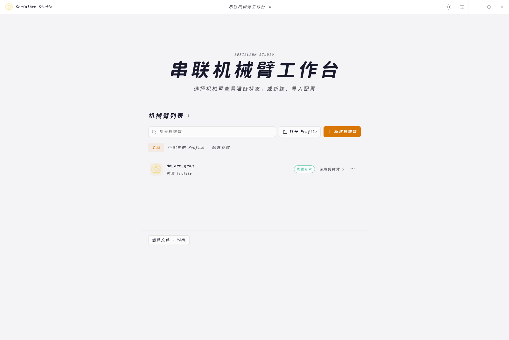
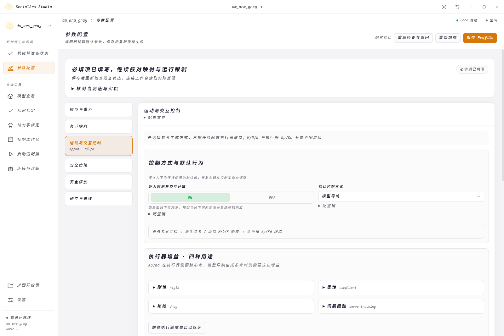
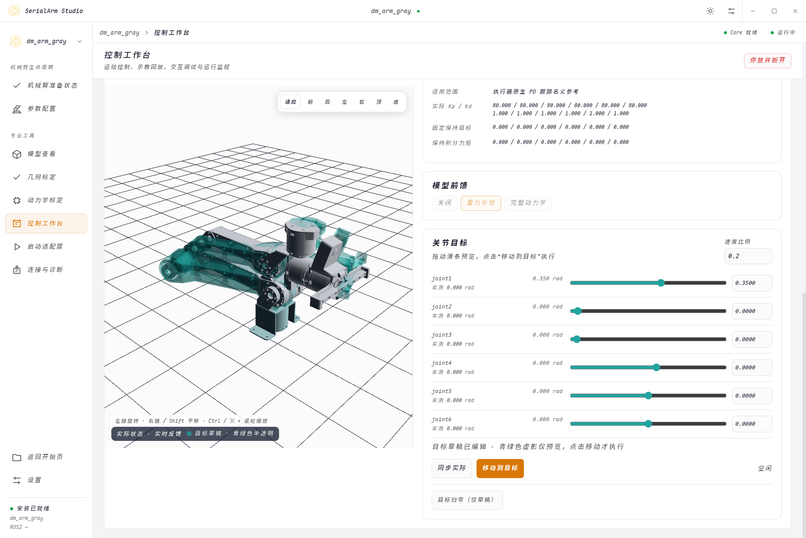
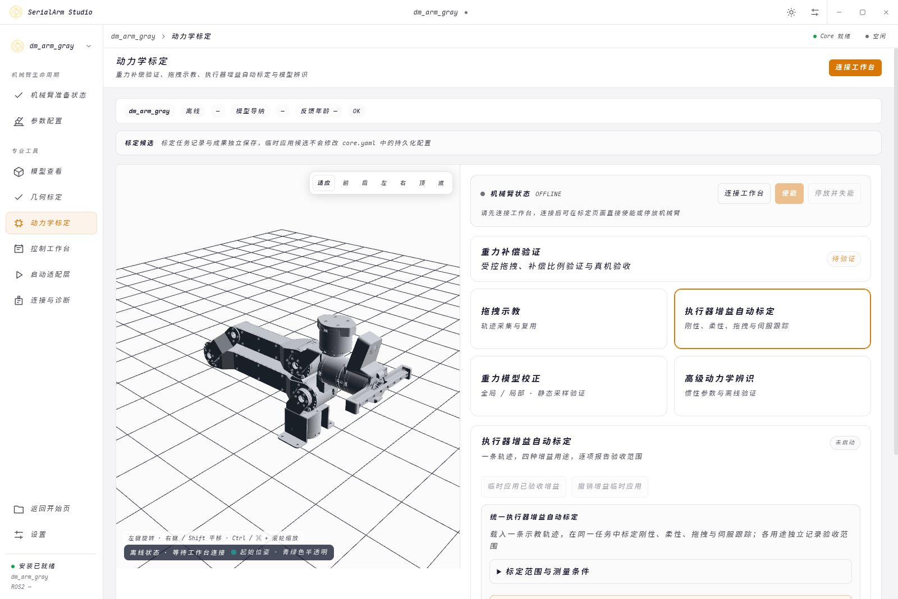

# SerialArm Studio 使用指南

SerialArm Studio 用于配置串联机械臂、查看模型、控制运动、示教回放与标定；Profile 关联模型、关节映射、控制参数和硬件资源，硬件通过对应驱动接入

首次使用按“打开或创建 Profile → 检查模型与映射 → 离线查看或连接硬件 → 重力补偿验证 → 执行器增益标定 → 控制与示教”进行

[安装与启动](install.md) · [配置与连接](#配置与首次连接) · [三维预览](#模型预览) · [基础标定](#重力与四用途增益标定) · [控制与示教](#控制与示教回放) · [专项标定](#模型与几何专项标定) · [诊断](#诊断与退出)

## 打开与创建机械臂 Profile



首页提供三个入口

从仓库根目录运行 `./launch.sh`；使用工作区副本时，从“打开机械臂 Profile”或 YAML 文件入口选择副本中的配置，并核对模型与资源路径；离线模型建议和诊断不会自动连接机械臂

| 入口 | 使用方式 |
| --- | --- |
| 打开机械臂 Profile | 扫描已有资源目录并选择配置 |
| 选择机械臂 Profile 文件 · YAML | 直接指定已有 Profile 文件 |
| 新建机械臂 Profile | 从 URDF、Xacro 或 Description 包创建配置 |

新建时选择实际 Base 与 Tool，检查主串联链、受控关节及顺序；`tool_frame` 使用实际末端坐标系，旁支夹爪不会自动加入主臂控制链

Xacro 导入使用工作台自带的 Python 依赖，`$(find package)` 从模型包、资源搜索路径和已安装资源解析，无需加载 ROS2 环境；创建时收拢所引用的网格包和外部资源，生成模型使用包内相对路径

模型缺少限位、结构不合法或资源缺失时，先修正指出的 URDF 或资源，再创建 Profile

自己的机械臂在下游项目维护 Profile、模型与 Hardware Backend；ROS2 Controllers 和 MoveIt 资源仅在使用对应适配层时提供，资源选择与安装见 [安装](install.md)

仓库内置 `dm_arm_gray` 和 `dm_arm_white` 示例，配置入口为 [`robot_profiles.yaml`](../src/robot_supports/profiles/config/robot_profiles.yaml)；示例零位、比例和增益对应具体机构，新的机械臂需填写自己的映射和限制

## 配置与首次连接

### 填写配置



参数页按模型、关节映射、运动与交互、安全、停放、硬件与总线分组；准备页的待办可定位具体字段，保存后返回重新检查

| 内容 | 字段或文件 | 核对内容 |
| --- | --- | --- |
| 模型 | `model` | URDF、关节顺序、Base、Tool、重力方向 |
| 关节映射 | `calibration.joints` | 方向、位置与力矩比例、关节与执行器零位 |
| 运行 | `control.runtime` | 控制周期、写入开关、前馈、默认跟踪用途 |
| 执行器增益 | `control.controller` | 刚性、柔性、拖拽、伺服跟踪的逐关节 Kp/Kd |
| 保持补偿 | `control.hold_compensation` | 原生刚性保持的积分范围、变化率和冻结条件 |
| 模型导纳 | `capability.admittance` | 外力观测、M/D/K、响应目标和退让限制 |
| 安全与停放 | `safety_policy`、`shutdown` | 超时、限位、力矩预算、恢复条件、停放目标与路径 |
| 硬件 | Hardware YAML | 驱动、总线、设备、执行器 ID 和型号 |
| 可选适配 | Profile 的 `controllers`、`moveit` | 控制器、接口、SRDF 与规划关节匹配 |

编辑器修改的是待保存值；连接覆盖、会话调参和标定试用值分别显示，保存前检查目标文件与差异；输入错误保留在原字段，切换分组后仍可修正

同页保存、重载、自查或列表刷新保留滚动位置、展开内容与当前焦点，方便继续核对；主动切换页面或参数分组时从新内容顶部开始

确认放弃修改后，返回参数页重新读取磁盘配置；取消离开或目标页面加载失败时保留草稿

### 区分控制方式、增益用途与任务

| 选择 | 含义 |
| --- | --- |
| 原生阻抗 | 执行器按名义参考和所选 Kp/Kd 执行，前馈可关闭、仅重力或完整动力学 |
| 模型导纳 | 外力估计驱动 M/D/K 虚拟模型，由伺服跟踪增益跟随退让参考 |
| 刚性、柔性、拖拽、伺服跟踪 | 四种执行器增益用途 |
| 保持、移动、拖拽 | 当前任务状态 |

`control.controller` 使用同级的 `allow_full_cmd`、`rigid`、`compliant`、`drag` 和 `servo_tracking`；刚性与柔性分别包含 `hold`、`tracking`，拖拽与伺服跟踪直接包含 `kp`、`kd`，每组都须提供完整逐关节数值；保持与跟踪是用途内的任务参数

新建、保存和导出统一使用四用途结构；旧平铺六组字段及 `identification_tracking` 兼容读取，旧 GUI 生成的 YAML 锚点自动展开；新旧字段同时描述同一任务时须等值，冲突会被拒绝

默认跟踪用途由 `control.runtime.tracking_gain_profile` 选择 `RIGID`、`COMPLIANT` 或 `SERVO_TRACKING`；旧配置缺少该字段时从 `tracking_impedance_mode` 推导

`capability.admittance.enabled` 开启外力观测与交互计算，`reference_behavior` 选择默认控制方式；只开启观测而选择原生阻抗时，不产生导纳位移；刚性保持补偿单独配置，只作用于原生阻抗下的刚性保持

### 先离线查看

新 Profile 默认关闭 `control.runtime.write_enabled`；模型和必要 Core 参数检查通过后，即可连接离线会话，硬件插件、型号和电机 ID 可在接入实机时填写

离线反馈和执行器能力标记为 mock；实机使用前核对硬件、手动开启写入并重新连接，读取真实反馈后再使能，启动确认不会更改写入开关

串口、波特率、Bus 和资源搜索路径可以覆盖本次连接，留空使用 Profile 默认值；多个资源目录用冒号分隔

### 接入硬件

1. 在“硬件与总线”选择已安装的对应驱动，或指定共享库路径，再导入该驱动的 Hardware YAML
2. 核对设备、总线和各轴执行器映射，填写适合机构的增益、安全限制及停放姿态
3. 确认机械支撑、急停或断电手段及运动空间，手动开启写入，保存并连接
4. 先在未使能状态逐轴检查反馈、单位和零位，再以小幅低速运动核对方向与限位
5. 完成重力补偿验证和执行器增益标定，再按需要开展交互调试与专项标定

导入硬件文件先更新草稿，保存后才写入当前 Profile；缺少驱动时安装对应组件或指定共享库，驱动开发见 [Hardware Backend 接口](reference/api.md#motorbus)

达妙驱动示例选择 `serial_arm_hardware_damiao`，可初始化内置硬件字段；填写设备路径、波特率、Bus、每轴电机型号、motor ID 与 master ID，同一总线的 motor ID 必须唯一；其他驱动使用各自的 Hardware YAML

准备页分别显示配置有效性、连接反馈、标定条件和人工自查；“已自查”“部分自查”“相关参数已变化”用于留档，实机连接按当前模型、驱动、硬件与写入条件判断

## 模型预览



所有三维预览统一使用左键旋转、右键或 Shift 平移、滚轮缩放；鼠标在画布内时滚轮只缩放模型，画布外滚动页面

模型查看可切换 Visual、Collision、Link Frame、Joint Axis、Labels、质心和惯性图形；选择对象可查看参数并高亮，URDF 连杆惯性与 Core 约简后的有效惯性分别显示

关节滑条和数值框编辑同一组预览姿态；青绿色半透明虚影表示目标或参考，实体模型跟随实际反馈；编辑预览不发送执行器命令

### 三维兼容与恢复

| 模式 | 用途 |
| --- | --- |
| 正常 GPU 三维 | 日常预览，使用 Chromium 默认 GPU 选择 |
| 兼容三维 | 显卡预览异常时使用 Electron 自带的 ANGLE SwiftShader 软件后端 |
| 无三维救援 | 关闭三维，继续配置、查看数值、管理记录和导出 |

三种模式在设置的“三维渲染”中选择；“当前使用”显示实际生效模式，需要重启时另列待生效模式和手动重启入口

兼容模式保留关节姿态、目标虚影、轨迹、坐标系、质心和惯性展示；软件绘制增加 CPU 占用，因此降低像素密度和刷新频率，静止及窗口不可见时减少或暂停绘制，原生控制周期不变

兼容后端需要 `enable-unsafe-swiftshader`，会降低软件 WebGL 在 GPU 进程中的安全保证，Renderer 沙箱仍启用；切换前需用户主动同意，初始化失败不会静默启用

图形后端切换需要重启应用；有运行会话时先结束会话，再手动重启，切换模式不会自动提交停放或停止运动

WebGL 创建失败或上下文丢失时，预览区域提供错误详情、重试、图形诊断和兼容模式入口；网格缺失、读取或解析失败会列出资源、连杆与原因，“重新加载模型”保留可恢复的视角、图层和选择

图形诊断将模型加载、渲染器、显卡与驱动、启动参数、运行库和日志分开显示，可导出完整 JSON；图形错误与机器人连接、运动状态分别处理

无三维救援保留恢复入口；目标移动和回放等需要姿态预览确认的操作，须先恢复完整模型预览，跳过预览不会记为检查通过

## 重力与四用途增益标定

### 重力补偿验证

准备页的基础标定按“重力补偿验证 → 执行器增益自动标定”进行；先比较重力补偿比例和受控拖拽表现，发现模型问题时进入 [重力模型校正](#重力模型校正)，再验证新结果

手动示教、重力补偿验证和固定点几何采样留在原页操作；自动采集和回放使用居中标定卡，包含三维预览、各轴当前值、目标与差值，以及保持、取消和立即失能入口

### 执行器增益自动标定



1. 记录或导入已检查的示教轨迹，选择“四用途快速标定”，或选择“单用途精细标定”及刚性、柔性、拖拽、伺服跟踪中的一个用途
2. 核对负载、线缆和整条路径，按起点虚影对齐，查看逐轴当前值、目标、差值及门槛
3. 核对必要的误差目标，完全松手并确认开始；软件自动完成模型初始化、短测、候选比较和用途验证，卡片显示当前阶段、已用与剩余时间
4. 完成后查看各用途的跟踪、保持和拖拽测量，选择需要采用的用途，预览差异后应用、保存或导出

反馈过期时仍显示对齐目标，但当前值和差值不可用，自动回放不能开始；参数过渡与所需回放由软件安排，候选比较保持路径方向、速度和前馈条件一致

新一轮搜索的物理模型来自当前 URDF 的几何、质量、质心和惯量；软件先用恢复设计目标和路径姿态惯量生成起动候选，再由短测响应修正，不需要预先手工猜 Kp/Kd；整轨高性能设计值只作详情诊断，不直接作为起动增益；模型建议标记为未实测，模型缺失或计算无效时先按提示修正

离线重算建议保留既有运行与恢复参数，采用继续通过现有应用与保存入口；无示教时使用明确的恢复设计目标，不把人工速度／力矩限制当成已测机械能力

无需配置 PD 搜索上限；历史 `max_kp_override/max_kd_override` 和旧平铺 `limits.max_kp/max_kd` 会被忽略，硬件协议能力与位置、速度、加速度、力矩等限制仍然生效；记录区分请求增益与实际可编码增益

起动短测以新鲜实测位置为中心，软件先建立可见、可比较的运动响应；有新反馈但运动太弱时，在既有安全边界与剩余预算内自动调整增益、幅值和频段；反馈缺失或限幅则按相应故障／约束处理；详情保留实际中心、激励和退出原因，普通界面无需手动设置这些阶段

若更高增益只导致激励缩幅，或输入增加但行程没有继续改善，软件先保留整组参数作较慢补测；多频条件到边界时，预算允许便自动用同组参数作对称单频运动补测，再恢复三频辨识、独立扰动和用途验证；完整补测仍不足时整组进入保持并提示具体轴与原因，不继续等待其他轴升参，也不把测量不足记为通过

低质量拟合先补激励证据，不能直接当作增大反馈的理由；检测到参考没有要求的持续位置往复时，任务锁存 `CALIBRATION_RESPONSE_UNSTABLE`，经既有故障停止／保持路径退出；先查看故障与部分记录并检查机械臂状态，再由操作者决定恢复，不自动清故障后继续试验

设 T 为最初有效录制时长；两模式目标均为 12T，快速标定硬上限 15T，精细标定硬上限 24T；例如 25 秒轨迹分别对应目标 300 秒、最多 375 秒或 600 秒；录制与手动起点对齐不计入预算，自动初始化、短测、过渡、回放、等待、保持、拖拽、验证与收尾全部计入，重复导入和安全重定时不扩大预算

开始前显示原始时长、预计与最大耗时；软件根据实际单趟成本安排候选并预留验证和退出时间，达标可提前结束；预算不足以完成的下一轮不再启动，到期保存最佳完整实测结果并经现有保持或停止路径结束

结束卡片区分达标、测量完整但未达标、测量不足、时间到期、主动取消和执行故障；非成功结果保留到手动关闭，显示具体原因及受阻关节；主动停止显示为已取消，真实故障仍按原故障恢复入口处理

普通界面按每轴最大绝对跟踪误差设置和评价，可设严格 `<0.1°`；RMS 为辅助信息，逐控制周期记录的峰值用于验收；辨识曲线、候选比较和详细诊断放在展开详情

| 用途 | 测量内容 |
| --- | --- |
| 刚性 | 与伺服共享适用的基础响应与原生跟踪测量，保持参数实际参与整定，采用积分补偿时另测其保持效果 |
| 柔性 | 从共享模型生成候选，按其执行速度验证实际柔顺响应、整轨跟踪与定位保持 |
| 拖拽 | 全轴局部运动后释放，分别测量真实初速度、衰减与稳定性 |
| 伺服跟踪 | 固定候选后的整轨原生跟踪，启用模型导纳时增加导纳轨迹测量 |

启动时有界等待稳定采样窗口；到限仍在回稳时记录警告并继续，不把漂移当作静止噪声；反馈中断、无效数值和 Safety 故障按执行故障处理

跟踪候选由模型与短测响应生成，并按可比实测小步修正；实测没有改善时退回已测参数，最终使用一整组已测过的增益；刚性与柔性的保持参数另行整定和测量，不由跟踪候选覆盖；精细标定只更新所选用途

每趟结束继续保持端点，最多等待 2 秒让增益交接和新鲜反馈回稳，该时间计入总预算；仍需对齐时保留已测用途并停止后续回放

拖拽测试在结束姿态附近进行，每轴局部偏移最多 `0.04 rad`，约 `2.29°`，同时受位置、速度、加速度和力矩限制；建立运动后切换零 Kp 拖拽参数，逐轴记录释放速度与衰减，未运动的轴不计为通过

定位保持分别显示静态到位误差、位置漂移和受扰恢复；积分有建立期与最终验收窗口，失败试验也保留实际配置与状态；拖拽衰减按连续位置变化判断，原始速度峰值单独留作诊断；原生 Safety 仍按配置检查实际位置、速度、力矩和执行故障

末端接触力 `±0.5 N` 需要接触力测量数据；本流程不提供末端恒力控制，不以关节误差或观测器外力矩代替该验收

### 结果、应用与导出

| 结果 | 含义与后续操作 |
| --- | --- |
| 达标 | 已完成测量并达到本次参考指标，可采用对应用途 |
| 警告 | 已完成测量但部分指标未达参考值，仍可应用、保存、导出并用于正常控制 |
| 未测或未完成 | 尚无完整测量，先完成该用途；已完成的其他用途可单独采用 |
| 执行故障 | 查看反馈、Safety 和原始记录，处理具体故障后重新开始 |

`available` 表示跟踪、保持或拖拽所需参数已完成实测，`qualification_complete` 表示抗扰等验收证据也完整，`validated` 表示参考指标达标；抗扰不足时，已有完整参数仍可带警告临时应用、保存和导出；RMS、峰值、稳定时间和刚柔分离等指标不作为完整参数测量结果的应用硬门槛

现代历史任务会按已有整轨、保持及实际执行需求核对参数是否测完，修正旧聚合标志隐藏实测结果的问题；读取不改写原记录，也不补成通过；切换候选仍使用现有失能与上下文检查

预算用完或被保持中断时进入保持并保存部分结果，未选用途保留现有参数；可选保持补偿复测中断不删除已完成的基线，只有实际完成的补偿状态才随结果提供

候选页列出逐轴增益、硬件协议能力、误差、是否达标、主要原因、保持结果与对应 CSV；任务包包含模型初值及来源、模式与可信 T、预算与耗时、`servo-probe-*.csv` 短测、整轨、静止采样和拖拽衰减记录；`frames.csv` 保留各层参考、实际反馈、限幅、积分、独立扰动及请求／可编码增益，协议码未知时标为 `-1`；短测与整轨另保留实际执行增益及其有效标识，末次拖拽结果不会覆盖其他用途的测量

临时应用只影响当前会话；保存和导出按勾选用途写入跟踪、保持及实际采用的补偿状态，有限值、维度、硬件协议能力和失能切换要求仍需满足

历史候选应用前核对模型、关节映射、补偿、控制频率和硬件上下文；发生变化后不能沿用旧条件直接应用；导出仅在上下文一致时合并当前配置，否则使用任务快照和实测上下文，并在提示及包内 `README.txt` 说明来源与差异

柔性候选保留测量时的刚性参考，参考与当前采用值不同时提示；更换路径或负载后，可在“交互调试”记录普通示教回放，再回候选页补充路径验收，记录至少 2 秒和 100 个有效样本，期间模型、增益与控制方式保持一致

整轨结果只覆盖本次示教路径与条件，旧局部探测记录保留原采样范围；测量指标与辨识方法见 [标定参考](reference/calibration.md)

## 控制与示教回放

### 状态与控制

控制、几何标定、动力学标定、连接与诊断及启动适配层页面，在模式选择上方固定显示机械臂状态卡；模型查看、准备页和参数页不显示此卡

第一行显示状态点与实际状态：`ACTIVE`、`INACTIVE`、`OFFLINE` 或 `FAULT`；第二行分为两组操作：“使能、停放并失能、立即失能”和“当前位置刚性保持、柔性恢复、清除故障”，可用性由实时状态决定

先连接，在反馈正常且无故障时使能；“控制参数”默认展开，控制方式和模型前馈在失能状态切换，运行中的任务状态与增益用途分别显示

| 操作 | 结果 |
| --- | --- |
| 拖动关节目标或编辑数值 | 实时更新青绿色目标虚影 |
| 移动到目标 | 提交预览目标，启动运动 |
| 同步实际 | 将新鲜反馈填入目标草稿 |
| 目标归零 | 仅修改草稿与虚影 |
| 当前位置刚性保持 | 停止移动，捕获当前实测位置作为刚性保持目标 |
| 停放并失能 | 沿配置路径到停放姿态后失能 |
| 立即失能 | 直接撤去驱动，操作前可靠支撑机械臂 |

“当前位置刚性保持”保留已选控制方式；原生阻抗使用刚性增益，模型导纳使用其要求的伺服跟踪增益；普通模式交接保留原名义目标，不把受扰偏移当作新保持点

速度比例须在 `(0, 1]`；目标显示当前有效限位，旋转关节可选 rad 或 °，直线关节可选 m 或 mm，Core 使用 rad 或 m

运动执行期间仍可编辑下一目标、同步实际位置、归零或填入轨迹端点；这些操作只改变草稿与虚影，原动作继续显示完成、失败或中断，结束后才能再次提交移动

命令提交后查看执行编号与到位状态，参考结束且新鲜反馈持续满足逐轴位置、速度容差后才显示完成

### 示教回放

1. 连接并使能，开始示教后进入拖拽，在安全范围内记录并结束
2. 检查轨迹并命名保存，或从轨迹管理导入 ZIP
3. 选择轨迹，通过时间轴查看整段姿态，再“载入所选轨迹到当前会话”
4. 选择正放、倒放或往返次数，以及速度、控制方式和跟踪增益用途
5. 核对起点虚影和逐轴误差；需要移动时，将起点填入目标草稿，在控制页预览并移动
6. 回到回放页确认起点与完整路径，松手后开始回放

正放为首点到末点，倒放为末点到首点，各执行一个单程；往返 N 次为 2N 个单程，起点预览随方向更新；回放速度比例须在 `[0.05, 1]`

| 回放 | 旋转关节起点容差 | 直线关节起点容差 |
| --- | --- | --- |
| 普通回放 | 位置 `0.08 rad`，速度 `0.05 rad/s` | 位置 `1 mm`，速度 `1 mm/s` |
| 触点往返 | 位置 `0.03 rad`，速度 `0.03 rad/s` | 位置 `0.5 mm`，速度 `1 mm/s` |

模型导纳回放统一使用伺服跟踪增益；原生阻抗可使用刚性、柔性或伺服跟踪，拖拽用途不用于轨迹回放

GUI 与 C++ Terminal 的普通示教临时使用原生阻抗和重力补偿，结束后恢复控制上下文；轨迹管理可在未连接时使用，模型、关节顺序、映射或坐标系变化后的旧轨迹可查看和导出，回放须匹配当前配置

### 交互调试与监视

模型导纳可用“受扰后回位”或“自由移动，松手减速”生成 M/D/K 草稿，专家视图可直接编辑；`K=0` 时松手减速而不拉回原位置，响应时间是虚拟模型指标，实际效果通过记录检查

应用交互参数只影响本会话，按控制周期平滑过渡；保存默认值需单独预览差异并确认

响应记录包含名义参考、导纳参考、最终参考与实测运动；记录期间保持增益和控制方式一致，切换前先结束记录；关节反馈用于关节回位判定，针尖精度需录入独立外部测量

运行监视显示关节和执行器反馈、反馈年龄、加速度有效性、观测器、逐级参考、力矩预算及限幅原因

## 模型与几何专项标定

### 重力模型校正

1. 拖动示教一条覆盖目标姿态的安全路径
2. 检查训练与留出姿态分配，松手后确认双向静态和多速度采集
3. 保存任务，比较基线与候选的训练、留出误差
4. 选定候选及重算轮次，审核差异后临时应用或导出，再用独立会话验证

自动阶段可暂停、继续、取消、保持和立即失能；暂停后位置变化过大须重新确认；摩擦双向回放前需完整预览，并停在示教末点，每个单程检查端点、静止速度和 150 ms 内的新鲜反馈，不自动移动对齐

在线预览固定质量与质心处惯量，只校正静态重力相关的一阶矩；离线静态重算可同时辨识质量和一阶矩；运行时重力覆盖不替换质量矩阵与科氏项，不能配合 `FULL_INVERSE_DYNAMICS` 或 `FULL_ID` 使用

候选应用与恢复在失能且无活动模型任务时执行；保存写入独立校正文件及 `gravity_correction_path`，保留备份；相同候选用于保存覆盖和导出 URDF

动力学参数、控制链、映射、重力向量、补偿比例或校正内容变化时，会撤销 `gravity_model_validated`；故障柔性恢复需在当前机械臂与负载下重新核对，再到安全策略确认；恢复旧备份不恢复过期确认

静态验证通过表示达到当前误差容差，`prior_preferred=true` 或保留先验表示本轮未支持参数更新；拟合、指标和 CLI 见 [标定参考](reference/calibration.md)

### 高级动力学辨识

按“数据检查 → 辨识设置 → 结果与推荐 → 导出”操作，选择静态重力或完整惯性、全局或局部范围；局部模式中可信连杆从求解开始保持固定

拟合、重算和采集审计前断开运行会话；查看记录与普通成果导出可在连接期间进行，保持和失能命令继续响应

报告区分别显示原始、去偏置误差与推荐结果；模型改善按实际导出模型的原始预测判定，推荐保留源模型时仍可查看物理拟合对照；输入条件、独立会话要求和导出类别见 [标定参考](reference/calibration.md)

报告与候选 URDF 保存在同一目录；选择轮次后，应用与导出核对对应模型及来源，移动数据时保留关联源任务

### 几何标定

固定点工具提供临时针尖 FK 一致性诊断和 TCP 位置候选，使用训练姿态求解、独立姿态验证；方法辨识 TCP 平移，朝向沿用父 Frame，恢复时使用记录的实际 Frame

临时诊断仅导出报告；正式 TCP 候选先预览 Frame、偏移和文件差异，再导出独立 URDF、Core、Hardware、Profile 与网格资源；断开会话后确认采用，将其登记为新机械臂，原模型与配置保留

重标定已采用的 TCP 时，程序将相对旧 TCP 测得的偏移转换回父 Frame，预览中显示更新操作与采样参考坐标系

重复到位测试从触点 B 记录到安全点 A；循环从 A 倒放到 B、停留，再沿记录方向回到 A，旧的 A 到 B 轨迹需重新示教；循环和撤离使用所选控制方式与跟踪增益，模型导纳使用伺服跟踪

先留接触间隙并低速核对路径，再做接触试验；循环可停止并保持，B 附近可沿记录路径撤离到 A；工具不测量接触误差，也不提供自动碰撞检测，定量重复定位精度需独立测量

## 诊断与退出

会话连接、启动或停止期间，Profile 管理器与诊断页均保留当前机械臂；先断开会话再切换，电机处于 INACTIVE 时同样适用

参数页有未保存修改时，关闭窗口、退出应用和重启图形模式先显示原生放弃修改确认；取消保留草稿与会话，选择放弃后仍需完成已有会话停止确认；若在后续确认取消，草稿仍保留；图形偏好与重启只在全部确认完成后提交

故障弹窗显示原因和处理结果，错误码与完整诊断可展开或复制；关闭弹窗保留故障状态，通信超时后先检查硬件与实际运动状态，不直接重复执行结果未知的命令

正常断开工作台等待停放和失能，停放失败保留连接并显示原因；立即失能与强制退出前先可靠支撑机械臂，FAULT 或通信中断时现场确认是否仍有保持力矩

后台已退出但界面状态未更新时，关闭窗口要求确认支撑、急停或断电条件；确认后只清理本次启动的已知进程并退出，本地进程退出不记为电机已失能

配置、文件和权限诊断不打开设备，可从仓库根目录执行

```bash
./launch.sh --doctor
./launch.sh --doctor \
  --profile your_robot \
  --profile-file /absolute/path/robot_profiles.yaml \
  --resource-paths /absolute/path/workspace
```

`Missing gripper_left` 表示缺少夹爪关节状态；内置白色模型的 Hardware 默认只接入 joint1 到 joint6，真实夹爪需提供对应驱动与状态接口

## 数据与导出

| 操作或数据 | 位置与影响 |
| --- | --- |
| 语言、主题、窗口与连接偏好 | `~/.config/serial-arm/launcher.json` |
| 安装日志 | `log/unified/` |
| 示教轨迹 | 当前机械臂数据目录的 `.serialarm/teach-replay/`，支持 ZIP、重命名与删除 |
| 标定任务 | 保存 metadata、采样、轨迹、结果和 `source/`，离线重算按轮次归档 |
| 会话数据导出 | 当前 Profile 的 `.serialarm/exports/` |
| 保存配置 | 预览差异后写入所选文件，保留备份 |
| 导出 URDF 或 TCP 成果 | 使用明确候选和轮次，输出后独立验证 |

外部 Profile 数据目录按项目目录与 Profile 名称确定；项目目录与 Profile 同名时直接使用该目录，否则使用其下的同名子目录，修改 YAML 文件名不改变归属

旧记录迁移保留原文件；同 ID 同内容的轨迹去重，内容不同的轨迹使用独立 ID 并保留来源；无法确认归属的记录留在原处，已删除的迁移轨迹不会再次导入

导出任务时保留完整目录和 `source/`，新任务另存原始硬件配置、生效配置与本次连接覆盖；重算轮次可分别比较，保存和导出始终核对选定来源

## Terminal 与可选适配层

| 入口 | 用途 |
| --- | --- |
| `serial_arm_terminal` | 交互式 C++ 控制、调参与标定 |
| `serial_arm_terminal --machine` | GUI 使用的结构化 JSON 会话 |
| `hardware.launch.py` | 可选 ros2_control 与 Controllers |
| `moveit.launch.py` | 可选硬件、规划与 RViz |

GUI、Terminal 和 Python Session 使用原生 Core，启动不加载 ROS2；Hardware 与 MoveIt 按需加载已安装适配层及宿主环境，环境准备见 [安装](install.md)，调用与驱动接口见 [API](reference/api.md)

Python 交互终端需显式执行“停放失能 → 原生阻抗 → GRAVITY 与有效重力比例 → 使能 → 拖拽”，结束后在失能状态切回原控制方式

GUI 终端使用 PTY，Ctrl+Shift+C 复制、Ctrl+Shift+V 粘贴、Ctrl+C 中断；运行中连接参数固定，GUI 按实际设备路径互斥占用，直接运行底层程序需自行保证设备独占

保存任务的离线命令、候选选择和恢复配置见 [标定参考](reference/calibration.md)，源码构建与检查见 [开发说明](development.md)
