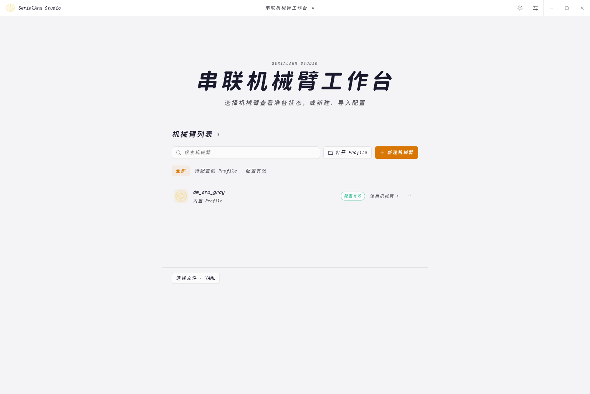

# 安装

SerialArm-Core 的 Core、Terminal、Python 与桌面工作台可独立运行；ROS2 和 MoveIt 是按需安装的适配层



## 构建方式一览

| 场景 | 推荐方式 |
| :--- | :--- |
| 首次使用桌面工作台 | `./install.sh` 后执行 `./launch.sh` |
| 已有 ROS2 工作区 | 在工作区根目录直接运行 `colcon build` |
| 独立 C++ 项目 | 按需安装 Core 后使用导出的 CMake Target |
| 调整安装组件 | 使用交互向导或安装脚本选项 |

### 直接在 ROS2 工作区构建

```bash
source /opt/ros/humble/setup.bash
colcon build
source install/setup.bash
```

Python Binding 默认启用，使用仓库内置的 pybind11 构建依赖，不会在配置期间联网获取该依赖

## 交互安装


在仓库根目录运行

```bash
./install.sh
```

Linux / Python 3.10+，ROS2 路径需预先安装 ROS2，GUI 需要 Node.js 20+ 和 npm

向导默认选择独立机械臂调试，输入提示标注 `[默认 2]` 或 `[y/n，默认 y]`，直接 Enter 使用默认值

| 选项 | 内容与用途 |
| --- | --- |
| 1 / `core` | Core + Dynamics，用于 C++ 集成 |
| 2 / `standalone` | Core + Terminal + Model Probe + GUI，不依赖 ROS2，DM-Arm 支持可选 |
| 3 / `python` | Core + Python Binding，独立 Python 环境，无 Terminal、ROS2 或 GUI |
| 4 / `ros2` | Core + Terminal + Python + ROS2 Adapter + DM-Arm + MoveIt + GUI |
| 5 / `dev` | 包含选项 4，并增加测试依赖与测试执行 |
| 6 / `custom` | Core 起步，逐项选择组件，自动补齐依赖 |

选项按集成需求组织，Python 是独立接口选择，并非每个编号都包含前一项

ROS2 必须包含 Python Binding，内置 MoveIt 必须包含 ROS2 与 DM-Arm 支持

选项 2、4、5 默认启用 DM-Arm，选项 2 可以在向导中取消

## Linux AppImage 与 deb 发行包

发行包只在准备 Release 时生成，日常修复、验证和安装不需要打包

默认发行包含 Core、Terminal、Model Probe、Python Binding、DM-Arm 支持和桌面工作台，不包含 ROS2 与 MoveIt 适配层

```bash
./build_linux.sh
```

脚本核对源码指纹、安装选项、原生产物和 GUI 来源，复用匹配的独立安装；需要重建时使用单任务编译，避免占满开发机

Electron 复用 `apps/launcher/node_modules/electron/dist` 已安装的运行时，不重复下载

```bash
# 只复用与源码一致的独立安装，不自动重建
./build_linux.sh --reuse-install

# 明确重建选定组件后生成发布包
./build_linux.sh --rebuild

# 可选：额外包含 ROS2 与 MoveIt 适配组件
./build_linux.sh --with-ros2
```

构建需要 Ubuntu 22.04 x86_64、Node.js 20+、npm 和系统 Python；只有选择 `--with-ros2` 才需要构建机安装 ROS2 Humble 与 MoveIt

两个产物及校验文件输出到 `dist/`

```text
SerialArm-Core-linux-x86_64.AppImage
SerialArm-Core-linux-amd64.deb
SHA256SUMS
```

将三个文件放在同一目录后，执行 `sha256sum -c SHA256SUMS` 校验

打包期间锁定安装入口，避免并发改写产物；运行记录与缓存不随发行包分发

### 安装发行包

目标机器使用 Ubuntu 22.04 x86_64；Core、模型查看、标定和桌面控制不需要安装 ROS2，也不读取 `/opt/ros` 环境

```bash
sudo apt install ./dist/SerialArm-Core-linux-amd64.deb
```

```bash
chmod +x dist/SerialArm-Core-linux-x86_64.AppImage
./dist/SerialArm-Core-linux-x86_64.AppImage
```

AppImage 需要 libfuse2 等系统运行库；发行包携带原生非系统依赖、Python Binding 和科学计算模块

首次启动时，内置机器人 Profile 复制到用户配置目录，供参数编辑与标定数据保存，不写入只读发行包

选择包含适配层的发行包后，也只有启动 ROS2 Hardware 或 MoveIt 入口时才加载宿主 ROS2 环境；缺少组件时显示安装提示，不影响 Core 和工作台

可选适配运行环境按需安装

```bash
sudo apt install ros-humble-ros2-control ros-humble-ros2-controllers \
  ros-humble-robot-state-publisher ros-humble-xacro ros-humble-moveit
```

Release 前在不含 ROS2 的 Ubuntu 22.04 环境检查 GUI、模型、Profile、Terminal 和 Python；若发布适配层，再单独检查 ROS2 与 MoveIt

## sudo 与日志

apt 和 rosdep 在当前终端显示输出与密码提示，同时记录命令输出

密码由 sudo 直接读取，安装器不读取或记录密码

`--yes` 仅跳过安装确认，仍可能要求 sudo 密码

无终端运行需要已授权的 sudo 凭据或免密权限，缺少权限会退出并给出提示

运行日志位于 `log/unified/<时间>/`，失败后修复日志中的问题并重跑同一命令

## 常用命令

```bash
# 独立工作台，按需添加 Python Binding
./install.sh --preset standalone --with-python --jobs 1 --yes

# 明确选择 ROS2 与 MoveIt 适配层
./install.sh --preset ros2 --yes

# 外部机器人，仅构建通用 ROS2 Adapter
./install.sh --preset ros2 --robot none --without-moveit --yes

# 自定义非 ROS 的 DM-Arm + Python + Terminal + GUI + Tests
./install.sh --preset custom --robot dm_arm \
  --with-terminal --with-python --with-gui --with-tests --yes

# 单独补装 GUI，保留已有 Core 安装状态
./install.sh --gui-only --yes

# 只输出 JSON 计划，不安装或写文件
./install.sh --preset ros2 --dry-run
```

非交互运行必须提供 `--preset`，`standalone-dm` 是 `standalone` 的兼容别名

| 参数 | 作用 |
| --- | --- |
| `--with-<组件>` / `--without-<组件>` | 组件为 terminal、python、ros2、moveit、gui、tests |
| `--robot dm_arm` / `--robot none` | 启用或省略内置机器人支持 |
| `--jobs N` | 并行数，默认 CPU 数且上限 8 |
| `--ros-distro humble` | 使用 `/opt/ros/<发行版>/setup.bash` |
| `--skip-system-deps` | 跳过 apt 与 rosdep，系统依赖自行准备 |
| `--allow-source-build` | 明确允许 Conan 缺少 binary 时编译依赖源码 |

系统依赖齐全时直接使用 CMake packages，否则优先获取 Conan binary

缺少 Conan 时准备本地工具 venv，`--yes` 不会允许大型依赖源码回退

独立 Python Binding 安装在安装前缀的 venv 中，GUI 使用 `.install/gui-venv`

## 安装后

```bash
./launch.sh
./.install/run serial_arm_terminal --robot-profile dm_arm_gray
./.install/run serial_arm_model_probe --help
./.install/run python -c 'import serial_arm; print("serial_arm import OK")'

# 或在当前终端加载一次环境
source .install/setup.bash

# 仅调用 ROS2 适配时加载 ROS 环境
source .install/ros2-setup.bash
# 或通过运行入口自动选择
./.install/run ros2 pkg prefix serial_arm_ros2_control
```

命令需要对应组件已安装，Terminal 运行可能连接真机

构建与安装产物按组件组合放在 `build/unified/` 和 `install/unified/`

`.install/manifest.json` 保存最后通过离线检查的安装状态，`.install/last_attempt.json` 保存最近结果

离线检查包括库加载、Terminal help、Model Probe help、Python import、ROS package 与资源存在性，不启动机器人

失败不会提交新 manifest，但同一安装前缀可能留下部分产物，需要完成重试

仓库搬移后重新安装以更新环境路径，安装器不修改 shell 启动文件、Profile 或串口权限

手动构建与验证命令见 [开发说明](development.md)
