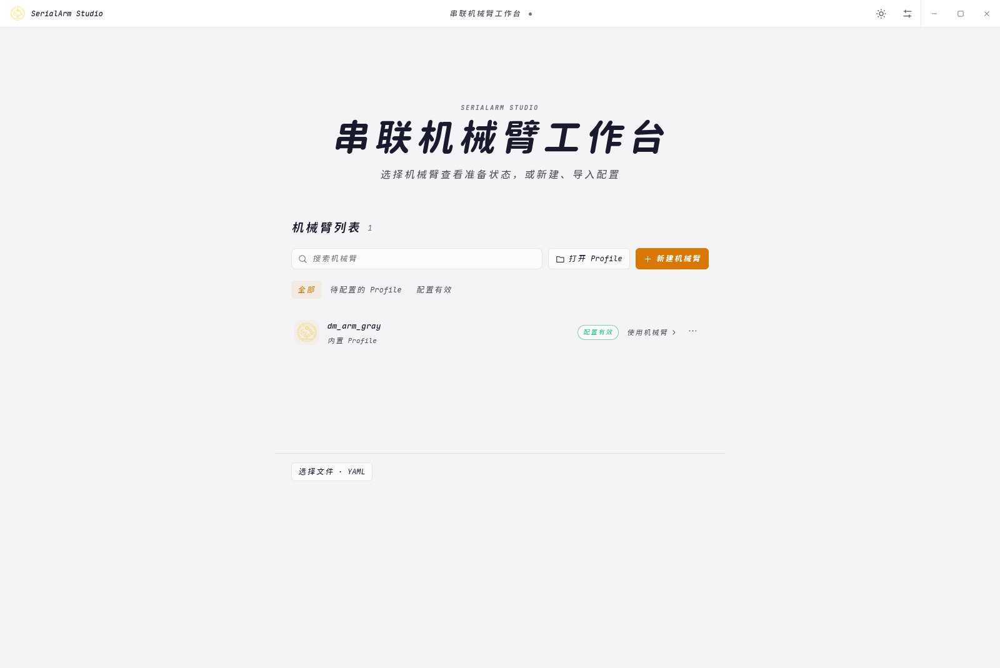
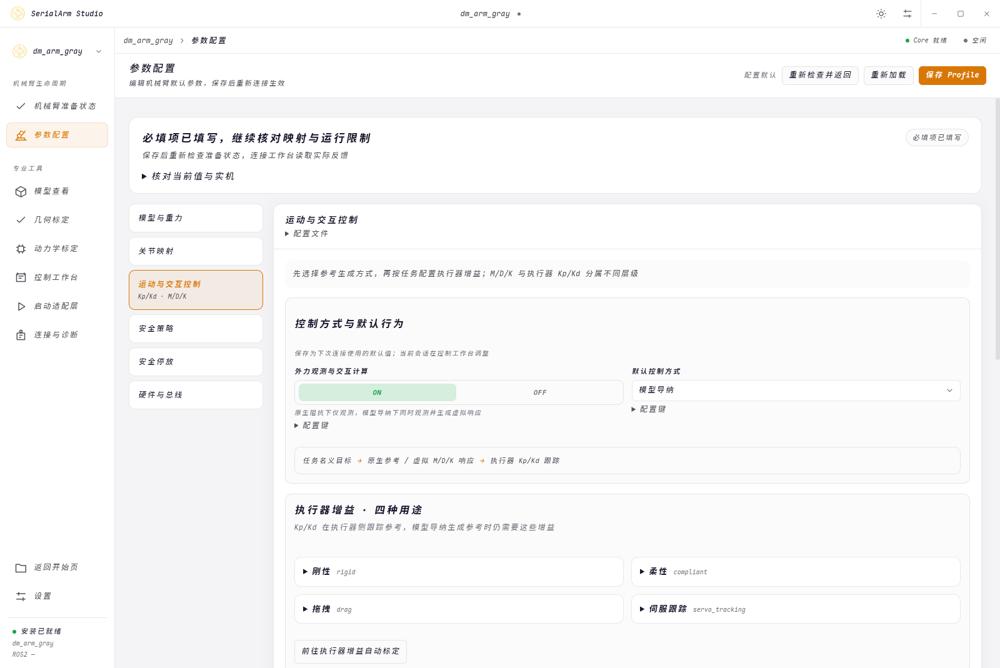
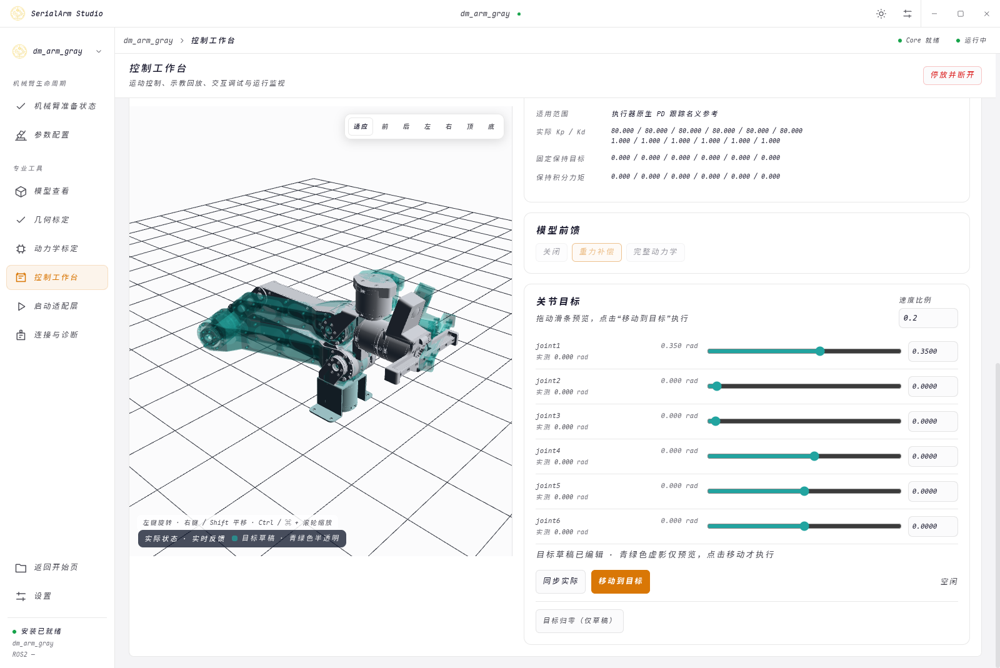
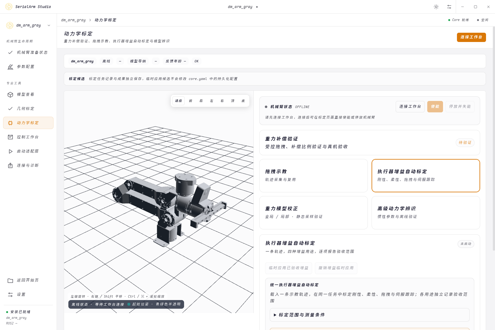

# 串联机械臂工作台

工作台用于配置机械臂、检查模型、控制运动、示教回放与标定

## 打开与选择机械臂

```bash
./install.sh
./launch.sh
```

已有 Core 时可用 `./install.sh --gui-only --yes` 补装 GUI；环境要求与发行包使用方式见 [安装](install.md)



从机械臂列表选择内置或外部 Profile，也可以导入 URDF、Xacro 或 Description 包创建新的配置

Profile 保存模型、关节映射、控制参数与硬件资源引用；外部机械臂的资源由自己的项目维护

串口、波特率、Bus 和资源搜索路径可以覆盖本次连接，留空使用 Profile 默认值；多个资源目录用冒号分隔

## 检查配置与连接

机械臂准备页面分开显示配置、运行、标定与记录

| 区域 | 检查内容 | 使用方式 |
| --- | --- | --- |
| 连接前配置 | 模型、关节映射、驱动、控制与安全参数 | 按具体待办跳转配置字段，保存后返回检查 |
| 运行检查 | 连接后的反馈、执行器状态与当前故障 | 连接工作台后查看，异常时按故障原因处理 |
| 基础标定 | 重力补偿验证 → 执行器增益自动标定 | 先验证补偿，再生成并验收执行增益 |
| 专项标定 | 重力模型校正、高级动力学辨识、几何标定 | 按模型与应用需要选择 |
| 检查记录 | 操作者备注、已导入的验证结果 | 对照配置与记录来源，配置变化后重新核对 |

配置有效表示满足连接前检查；能否使能和发送运动仍由当前反馈、硬件状态与 Core 安全检查决定

“运动与停放”进入控制页的机械臂运行区，检查使能、保持与停放；专项标定通过同级卡片进入对应工具

连接前核对电机 ID、方向、零位和限位；开启 `write_enabled` 后程序才会向真实执行器写入命令，启动确认不会修改这个开关

## 参数配置



参数按模型、关节映射、运动与交互、安全、停放、硬件与总线组织；点击待办定位具体字段并短暂高亮，完成后保存并返回检查

运动与交互配置分为三部分

- 默认控制方式：原生阻抗或模型导纳
- 执行器增益：刚性、柔性、拖拽、伺服跟踪；刚性与柔性的保持和跟踪数值分别保存
- 模型导纳：外力观测、交互响应目标、M/D/K 和退让限制

默认跟踪用途由 `control.runtime.tracking_gain_profile` 选择刚性、柔性或伺服跟踪；旧配置缺少此字段时沿用 `tracking_impedance_mode` 推导的用途

刚性保持补偿在 `control.hold_compensation` 中配置，只作用于原生阻抗下的刚性保持

配置编辑器修改的是保存值；连接覆盖、会话调参和标定试用值分别显示，保存前检查目标文件与差异

## 模型查看

模型查看读取 Core 加载的 URDF 与动力学结果，显示机器人结构、关节轴、坐标系、质心与惯性



可单独切换 Visual、Collision、Link Frame、Joint Axis、Labels 和惯性图形；选中对象后可查看其参数并高亮显示

关节滑条与数值框编辑同一组预览姿态；模型预览不发送执行器命令

URDF 中的连杆惯性与 Core 约简后的有效惯性分别展示，无效参数对应的惯性图形不可用

## 控制工作台

| 页面 | 用途 |
| --- | --- |
| 控制 | 使能、停放、保持、控制方式、增益用途与关节目标 |
| 示教回放 | 记录、保存、导入轨迹与设置回放 |
| 交互调试 | 调整本会话交互响应，记录并分析受扰响应 |
| 运行监视 | 查看反馈、参考链路、外力估计、命令力矩与限制原因 |

### 控制

先连接工作台，在反馈正常且无故障时使能；任务状态显示保持、移动或拖拽，增益用途显示刚性、柔性、拖拽或伺服跟踪

原生阻抗按名义目标执行，使用所选用途的执行器增益；模型导纳根据外力估计产生退让参考，统一使用伺服跟踪增益跟随该参考

控制方式与原生模型前馈在失能状态切换；工作台普通示教临时使用原生阻抗与重力补偿，结束后恢复原控制上下文

关节目标只保留一组滑条和精确数值框，青绿色半透明模型显示待执行目标；编辑后点击“移动到目标”才发送运动命令

“同步实际”把当前反馈作为新目标；目标归零只修改预览；“当前位置保持”停止当前移动并捕获当前位置作为保持目标

普通模式交接保留原名义目标，避免把受扰偏移当成新的保持位置

### 示教回放

1. 连接并使能，开始示教后进入拖拽
2. 在安全范围内拖动机械臂，结束记录后检查轨迹
3. 命名并保存，或从轨迹管理中导入已有轨迹
4. 选择回放方向、速度、循环次数、控制方式与增益用途
5. 核对青绿色起点预览，松手并确认路径后开始回放

正放起点是记录首点，倒放起点是记录末点；实际位置需与所选起点对齐

模型导纳回放使用伺服跟踪增益；原生阻抗回放可使用刚性、柔性或伺服跟踪，拖拽用途不用于轨迹回放

示教轨迹按机械臂保存在 `.serialarm/teach-replay/`，支持 ZIP 导入导出、重命名和删除；故障中断的录制会显示失败原因

### 交互调试

选择模型导纳后，可用“受扰后回位”或“自由移动，松手减速”生成所选关节的参数草稿；专家视图可直接编辑 M/D/K

响应时间是虚拟模型指标，实际效果通过响应记录检查；`K=0` 时松手后减速，不拉回原位置

应用只影响当前会话，运行中的参数按控制周期平滑过渡；保存为默认值需要单独预览差异并确认

响应记录包含名义参考、导纳参考、最终参考与实测运动；标记松手时刻后，可检查原目标、关节回位与外部针尖测量

关节反馈用于关节回位判定；针尖精度需录入独立外部测量，缺少测量时显示未验证

### 运行监视与故障处理

监视页显示关节与执行器反馈、反馈年龄、加速度有效性、观测器状态、逐级参考、力矩预算与限幅原因

故障弹窗显示原因和当前处理结果，错误码与完整诊断可展开或复制；关闭弹窗保留故障状态

停放会沿配置路径回到停放姿态后失能；立即失能直接撤去驱动，操作前需可靠支撑可能下落的机械臂

通信超时后先检查硬件和当前运动状态，执行结果未知的运动命令不要直接重复发送

## 基础标定与专项标定

准备页将标定分成两组：基础标定按“重力补偿验证 → 执行器增益自动标定”进行；专项标定包含重力模型校正、高级动力学辨识与几何标定，按当前需要进入

重力补偿验证用于比较补偿比例和受控拖拽表现；发现模型问题时进入重力模型校正，再验证新结果

## 动力学标定



各工具共享任务记录，但候选结果、验证范围与应用动作分别管理

### 执行器增益自动标定

选择刚性、柔性、拖拽、伺服跟踪或全部用途，填写负载与误差要求，在检查过的局部运动范围运行标定

| 用途 | 独立验证 |
| --- | --- |
| 刚性 | 冻结参数后的跟踪、保持；如采用保持补偿，另测补偿开启后的保持 |
| 柔性 | 相对刚性参考的增益边界、冻结参数后的跟踪与保持 |
| 拖拽 | 有界速度释放后的阻尼与稳定性 |
| 伺服跟踪 | 同一候选分别通过原生阻抗跟踪和模型导纳跟踪 |

结果记录实测误差、连续性、限幅、响应估计、负载与采样姿态范围；数据不足的响应参数显示未知

伺服结果还给出基于局部无接触数据的导纳参数参考范围；接触响应、松手回位和针尖精度按对应实测结果单独验证

候选应用前核对用途与验证结果；临时应用不会保存配置，导出时写入对应的跟踪、保持及已验证补偿状态

旧 `identification_tracking` 配置兼容读取为 `servo_tracking`；缺少导纳独立验证的旧辨识增益候选需要重新标定

### 重力模型校正

1. 拖动示教一条覆盖所需姿态的安全路径
2. 结束后检查训练与留出姿态分配
3. 完全松手，确认双向静态与多速度自动采集
4. 保存任务，比较基线与候选的训练和留出误差
5. 审核后临时应用或导出，使用独立会话验证

自动阶段可以暂停、继续、取消、保持或立即失能；暂停后位置变化过大时，继续需要重新确认

在线预览固定质量及质心处惯量，只校正静态重力相关的一阶矩；运行时重力覆盖不替换质量矩阵与科氏项，不能配合 `FULL_INVERSE_DYNAMICS` 或 `FULL_ID` 使用

候选应用与恢复在失能且无活动模型任务时执行；保存写入独立校正文件和 `gravity_correction_path`，保留校正前备份

任务目录保存 `metadata.json`、`frames.csv`、`trajectory.csv`、`result.json` 与源快照；新任务另存硬件原始配置、生效配置及本次连接覆盖，历史任务可在未连接硬件时扫描或直接加载

静态验证通过表示达到当前误差容差；`prior_preferred=true` 或保留先验表示本轮未支持更新参数

### 高级动力学辨识

按“数据检查 → 辨识设置 → 结果与推荐 → 导出”操作，可选择静态重力或完整惯性辨识、全局或局部范围；局部模式中勾选的可信连杆从求解开始保持固定

离线处理使用已保存任务；开始重算或导出前断开运行会话

原始与去偏置误差分别展示，模型改善按实际导出的原始预测判定；算法、导出条件及实验案例见 [离线重力辨识](reference/offline-gravity.md) 与 [完整动力学辨识](reference/dynamic-identification.md)

## 几何标定

固定点工具分为临时针尖的 FK 一致性诊断和 TCP 位置候选；采样训练姿态后，使用独立姿态验证

固定点方法辨识 TCP 平移，工具朝向沿用父 Frame；临时诊断只导出报告，正式 TCP 工具导出待审核候选

重复到位测试从触点 B 记录到安全点 A，循环时从 A 倒放至 B、停留，再沿记录方向返回 A；旧的 A 到 B 轨迹需重新示教

先留出接触间隙，低速核对路径，再执行接触试验；循环中可停止并保持，位于 B 附近时可沿记录路径撤离至 A

本工具不测量接触误差，也不提供自动碰撞检测；定量重复定位精度需独立测量

## Terminal、ROS2 与命令行

| 入口 | 用途 |
| --- | --- |
| `serial_arm_terminal` | 交互式 C++ 控制、调参与标定 |
| `serial_arm_terminal --machine` | GUI 使用的结构化 JSON 会话 |
| `hardware.launch.py` | 启动 ros2_control 与 Controllers |
| `moveit.launch.py` | 启动硬件、规划与 RViz |

Terminal、Python Session 与 ROS2 Adapter 复用 Core 控制运行时；ROS2 默认跟踪用途读取 Core 的 `tracking_gain_profile`

C++ Terminal 普通示教与 GUI 使用自动临时控制上下文；Python 交互终端需显式执行“停放失能 → 原生阻抗 → GRAVITY 与有效重力比例 → 使能 → 拖拽”，结束后由用户在失能状态切回原控制方式

终端使用 PTY，Ctrl+Shift+C 复制、Ctrl+Shift+V 粘贴，Ctrl+C 中断程序；运行中连接参数固定

GUI 按实际设备路径互斥占用，直接运行底层程序需自行保证设备独占

正常断开等待停放与失能，停放失败会保留连接并显示原因；强制结束会中断清理，需现场确认执行器状态

保存后的模型任务也可用 CLI 处理

```bash
python3 tools/model_calibration_cli.py inspect --directory /path/to/task
python3 tools/model_calibration_cli.py recompute --config /path/to/core.yaml --directory /path/to/task
python3 tools/model_calibration_cli.py preview-save --config /path/to/core.yaml --directory /path/to/task
python3 tools/model_calibration_cli.py save --config /path/to/core.yaml --directory /path/to/task --confirm
python3 tools/model_calibration_cli.py export-urdf --config /path/to/core.yaml --directory /path/to/task
python3 tools/model_calibration_cli.py restore-config --config /path/to/core.yaml --directory /path/to/task --confirm
```

## 诊断与偏好

诊断读取配置、文件和权限，不打开设备

```bash
./launch.sh --doctor
./launch.sh --doctor \
  --profile tomato_picker \
  --profile-file /absolute/path/robot_profiles.yaml \
  --resource-paths /absolute/path/workspace
```

语言、主题、窗口与连接偏好保存在 `~/.config/serial-arm/launcher.json`，安装日志位于 `log/unified/`；会话数据导出到当前 Profile 的 `.serialarm/exports/`

`Missing gripper_left` 表示缺少夹爪关节状态；内置白色模型的 Hardware 默认只接入 joint1 到 joint6，真实夹爪需要自己的驱动与状态接口

```bash
./.install/run ros2 topic echo /joint_states --once
```

`/recognize_objects not available` 表示物体识别 action 服务未启动，检查对应服务

开发和界面检查入口见 [开发与验证](development.md)
