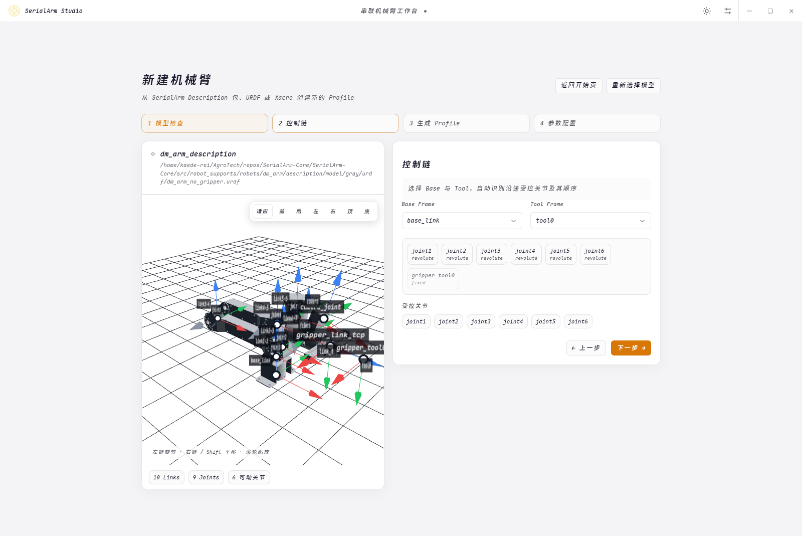
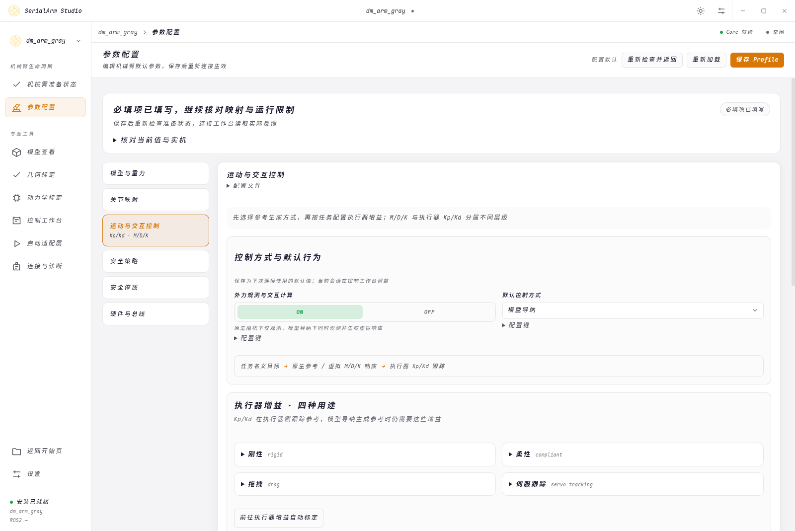

# 机械臂接入与配置

接入一台机械臂需要模型、执行器映射、控制参数与安全限制；这些资源通过 Robot Profile 关联



## 选择资源

内置 Profile 位于 `src/robot_supports/profiles/config/robot_profiles.yaml`

| Profile | Core YAML | MoveIt Package |
| --- | --- | --- |
| `dm_arm_gray` | `config/core/gray.yaml` | `dm_arm_no_gripper` |
| `dm_arm_white` | `config/core/white.yaml` | `dm_arm_with_gripper` |

内置零位、比例和增益对应具体机械臂；新的实例需要自己的标定与限位

下游项目可独立维护 `robot_profiles.yaml`、模型、Hardware Backend、Controllers 与 MoveIt 资源

```bash
./install.sh --preset ros2 --robot none --without-moveit --yes
export SERIAL_ARM_RESOURCE_PATH=/absolute/path/downstream/workspace
./.install/run serial_arm_terminal \
  --robot-profile your_robot \
  --profile-file /absolute/path/downstream/robot_profiles.yaml
```

安装预设提供通用 Core 与 ROS2 Adapter，下游驱动和资源包需构建并加载

## 创建与填写 Profile

在 GUI 导入 URDF、Xacro 或 Description 包，选择 Base 与 Tool 后检查主串联链和受控关节顺序

`tool_frame` 使用实际末端坐标系，旁支夹爪不会自动加入主臂控制链



| 内容 | 字段或文件 | 核对内容 |
| --- | --- | --- |
| 模型 | `model` | URDF、受控关节、顺序、Base/Tool、重力方向 |
| 映射 | `calibration.joints` | 方向、位置与力矩比例、关节与执行器零位 |
| 运行 | `control.runtime` | 周期、写入开关、前馈、默认跟踪用途 |
| 执行器增益 | `control.controller` | 刚性、柔性、拖拽与伺服跟踪 Kp/Kd |
| 保持补偿 | `control.hold_compensation` | 原生刚性保持的积分范围、变化率与冻结条件 |
| 交互 | `capability.admittance` | 控制方式、观测器、M/D/K 与退让限制 |
| 安全 | `safety_policy` | 反馈与命令超时、关节限位、力矩预算、恢复条件 |
| 停放 | `shutdown` | 停放目标、路径速度、容差与超时 |
| 硬件 | Hardware YAML | 驱动、总线、设备、执行器 ID 与型号 |
| ROS2 | Profile 的 `controllers` | 控制器、接口与关节匹配 |
| MoveIt | Profile 的 `moveit` | SRDF、规划关节与控制器匹配 |

参数页先显示缺项与具体位置；保存后返回准备页面重新检查

## 区分控制方式、增益用途与任务

| 选择 | 含义 |
| --- | --- |
| 原生阻抗 | 执行器按名义参考和 Kp/Kd 执行，前馈可关闭、仅重力或完整动力学 |
| 模型导纳 | 外力估计驱动 M/D/K 虚拟模型，伺服增益跟随退让参考 |
| 刚性、柔性、拖拽、伺服跟踪 | 四种执行器增益用途 |
| 保持、移动、拖拽 | 当前任务状态 |

刚性与柔性分别保留保持和跟踪数值，模型导纳固定使用伺服跟踪增益；GUI 与 C++ Terminal 的普通示教临时使用原生阻抗和重力补偿，结束后恢复上下文

Python 交互终端使用显式流程：停放失能 → 原生阻抗 → GRAVITY 与有效重力比例 → 使能 → 拖拽；结束后由用户在失能状态切回原控制方式

ROS2 默认用途由 `control.runtime.tracking_gain_profile` 选择 `RIGID`、`COMPLIANT` 或 `SERVO_TRACKING`；旧配置省略该字段时从 `tracking_impedance_mode` 推导刚性或柔性用途

增益标准字段为 `control.controller.servo_tracking`；旧 `identification_tracking` 兼容读取，保存时使用标准名称

`capability.admittance.enabled` 开启外力观测与交互计算，`reference_behavior` 选择默认控制方式；启用观测但选择原生阻抗时，只观测外力，不产生导纳位移

## 第一次连接

先检查模型、驱动资源与设备权限

```bash
./launch.sh --doctor --profile dm_arm_gray
./.install/run python3 src/serial_arm/core/app/serial_arm_terminal.py \
  --robot-profile dm_arm_gray --check-only
```

写入开关位于 Core YAML

```yaml
control:
  runtime:
    write_enabled: false
```

Terminal 在关闭写入时使用离线 mock；开启后使用实际 Hardware Backend，启动前核对实际值

先确认机械支撑、急停或断电手段，再核对通信、ID、反馈方向、量纲、零位与限位；以小幅低速运动检查每个关节

检查备注供操作者记录观察，连接和控制准入由当前配置、反馈与 Core 安全检查决定

串口、波特率与 Bus 可以覆盖本次连接

```bash
./.install/run serial_arm_terminal \
  --robot-profile dm_arm_gray \
  --serial-port /dev/ttyACM1 \
  --baudrate 921600 \
  --bus main_can
```

## 建立可用控制参数

先完成基础保持与低速跟踪；准备页的基础标定按“重力补偿验证 → 执行器增益自动标定”进行，再调试导纳交互

专项标定包含重力模型校正、高级动力学辨识与几何标定，按任务需要选择

增益标定按用途给出候选与独立验证，伺服跟踪同时验证原生阻抗与模型导纳；只部署与当前模型、映射及负载相符的结果

模型导纳先设定目标退让与响应时间，再生成 M/D/K 草稿；实际响应通过交互记录检查，接触任务需按实际环境验证

`K=0` 用于松手减速而不拉回原位置；原生刚性保持补偿与导纳分别配置，补偿只在对应保持条件下工作

## 预览、应用与保存

控制页的滑条和数值框编辑同一组关节目标，青绿色虚影显示预览；点击“移动到目标”才启动运动

“当前位置保持”捕获当前位置；普通模式交接保留原名义目标，受扰退让不会自动成为新保持点

| 操作 | 结果 |
| --- | --- |
| 编辑配置 | 修改待保存值 |
| 覆盖连接参数 | 只影响本次连接 |
| 应用会话参数或候选 | 只影响当前运行环境 |
| 预览差异并保存 | 写入选定配置文件，保留备份 |
| 导出 URDF | 生成候选模型文件，按导出范围审核后采用 |

正常断开等待停放与失能；立即失能前可靠支撑机械臂，FAULT 或通信中断时现场确认是否仍有保持力矩

详细操作见 [桌面工作台](launcher.md)，接口与兼容字段见 [API 参考](reference/api.md)
