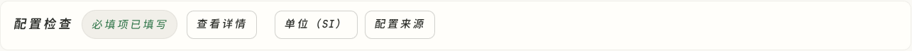

# 共享控件状态与参数布局验收

2026-11-26；本地工作区交付，完整包含相较 `fde6251` 的 UI 改动；使用生产 Launcher renderer 与离线 fixture

## 实现结果

- `styles.css` 明确普通表面、选中导航、主操作、输入边界与语义状态；微信绿三阶为 `#07C160 / #06AD56 / #059B4D`，实心绿使用白字/白勾；暗色表面使用独立层级
- `studio.css` 显式绘制普通 checkbox/radio，保留原生输入、键盘、事件与焦点；自绘参数 switch 独立；label 与控件内部同向反馈；选择卡片的普通与选中底分别参与现有选择插值；warning 使用对应文字/浅底/边框
- 机械臂资产承载面保持白色、边界明确，外层行承担交互反馈；原图比例、留白与颜色保留
- 参数标题整合当前 Profile；保存上下文区分编辑草稿、磁盘与会话；标题、保存、检查与编辑区共用最大 1280px 内容边界
- 检查详情、单位与来源在默认态即显示明确按钮边界与底色，保留 hover/pressed/focus-visible/展开状态；检查标题、状态与详情入口近距排列，单位/来源在附近；展开正文只向下增加，入口横向位置不变；缺失与错误计数统一为“待处理”，问题保留字段定位
- 编辑区为 180px 导航 + 24px 间距；容器不足 850px 使用已有分组选择器；普通字段最多两列、阅读宽度约 960px，长路径/选择器跨完整字段行
- 映射、增益与限制表格的共同单位移到列头、共同约束移到表下注，并保持可访问描述关联；轴条件变化后，差异提示回到轴字段，错误仍就地显示
- 继续使用分组局部更新、原始数值/显示值、草稿校验、焦点与滚动恢复、展开状态、sticky 遮挡计算；模型资源与业务状态机未重建

1000×720 中文模型参数页：本次基线首个可编辑输入框约 y=472，修改后 y=421，提前约 51px；URDF 路径独占完整行，基坐标系与工具坐标系同排可编辑

界面文案不使用中文句号，段末不加终止标点；清理中英文进度文案的省略号及少量英文句末点号，保留原始诊断、文件路径与数据格式

## 配色取舍

用户确认保留微信绿白字：`#07C160` / `#FFFFFF` 实际约 2.38:1，低于普通字 4.5:1 与适用非文本 3:1 目标；此项单独记录，其他文字、边界、焦点仍按最终合成背景检查；不将该取舍写为整应用 AA 通过

浅色输入默认边框 `#72736F`，hover `#4E6B59`，focus `#2E7658`；普通表面 `#FFFEFA → #F1EFE9 → #E6E4DC`；选中导航 `#D5EBDD → #C7E3D2 → #BADCC7`

## 软件关键文件

均相对于软件仓库 `/home/kaede-rei/AgroTech/repos/SerialArm-Core/SerialArm-Core`

| 文件 | 责任 |
| --- | --- |
| `apps/launcher/renderer/styles.css` | 双主题语义 token |
| `apps/launcher/renderer/studio.css` | 共享控件组合状态、资产底座、选择插值 |
| `apps/launcher/renderer/studio-inspector.css` | 参数范围、摘要、字段与表格布局 |
| `apps/launcher/renderer/app.js` | 参数结构、表格公共描述与差异恢复、保存上下文、段落文案 |
| `apps/launcher/renderer/studio-motion.js` | 可见摘要按钮复用已有原生 details 动效与焦点恢复 |
| `apps/launcher/scripts/verify-control-states.cjs` | 真鼠标/键盘事件、像素、计算样式与布局证据 |
| `apps/launcher/scripts/render-studio-ui.cjs` | 页面渲染、连续性与正确的禁用态检查 |
| `apps/launcher/scripts/verify-parameter-units.cjs` | 行内/共享单位描述、当前逐轴路径与共享编辑器 |
| `apps/launcher/scripts/verify-disclosure-scroll.cjs` | 实际可见摘要入口与位置稳定性 |
| `docs/development.md` | 项目色彩取舍与验证入口 |

## Skill 同步

Skill 完整提交：`f1cafdc743bce32cbc8c33e590b007e4106446cf`

技能目录：`/home/kaede-rei/AgroTech/repos/other/KR-Skills/robot-desktop-ui`；本机技能入口是该目录的符号链接

入口与设计系统区分通用原则、Kudu 默认示例、SerialArm 已确认映射；主题规范与 `assets/theme/calm-control.css` 独立定义普通/选中/输入/焦点状态，保留上游原色事实；预览 HTML 增加 SerialArm 明暗示例与原生 checkbox；组件、资产、布局配方、窄窗任务优先级和验证规则同步；`TEST_CASES.md` 补充组合状态、宽窄参数页、资产底座与项目配色取舍场景

## 实际验证

| 检查入口 | 实际结果 |
| --- | --- |
| `node scripts/verify.cjs` | Launcher 静态、原生 Python 运行时与相关既有约定通过 |
| `verify-control-states.cjs` | 87 项；6 组尺寸/主题/语言；38 张截图；真实鼠标与键盘事件、勾号像素、输入边界、卡片与导航状态、入口位置 |
| `verify-profile-layout.cjs` | 6 个生产页面布局/表格/滚动场景通过 |
| `verify-disclosure-scroll.cjs` | 两个窗口、136 项通过 |
| `verify-parameter-units.cjs` | 转动/移动/混合关节 × 中英文，6 变体、358 项通过 |
| `verify-interaction-flow.cjs` | 44 项通过 |
| `render-studio-ui.cjs --parameter-continuity-only` | 1000×720 与 1300×900、62 项、2 个渲染，0 findings；包括约束变化时共同说明恢复为轴内差异 |
| `verify-model-lifecycle.cjs --collision-geometry` | 同一 URDF 的真实 STL、SwiftShader，56 项通过；初始资源读取 9 次 |
| `render-studio-ui.cjs --render-only` | 常规与窄窗相关页面：1300×900 中文明暗 18 组，1000×720 英文明暗 8 组，均 0 findings；字体实际使用 Maple Mono CN Italic |
| 最终合成对比抽样 | 上述 18 组页面的现有文字抽样无低于 4.5:1 项；主操作绿底白字单独按已确认取舍记录，未将抽样写为全应用 AA |
| Skill 结构 | `quick_validate.py` 通过；相对引用全部可解析；原 Kudu 色表与独立项目映射分开保留 |

GLB 生命周期 fixture 在当前环境普通图形模式与 SwiftShader 下均出现 renderer 崩溃（exit 139）；GLB 验证尚未通过，不能由 STL 结果代替；本次没有改动模型加载器或 GLB 渲染实现

Skill 主题示例已在实际视口 1302px 与 1000px 渲染并核对明暗主题、三阶绿色、白字、warning 与白底资产；颜色均与项目映射一致；[技能示例截图](images/ui-state-layout-2026-11-26/skill-preview.png)、[计算样式记录](images/ui-state-layout-2026-11-26/skill-preview.json)

暗色机械臂列表追加渲染通过，0 findings；[白色资产底座的暗色截图](images/ui-state-layout-2026-11-26/asset-dark.png)

详细运行数据保存在 `/tmp/serialarm-state-layout/`；测试不连接实体设备、不使能、不运动、不写设备参数或磁盘 Profile

## 截图

[最终检查摘要按钮](images/ui-state-layout-2026-11-26/summary-buttons.png) · [按钮 Hover](images/ui-state-layout-2026-11-26/summary-hover.png) · [按钮 Pressed](images/ui-state-layout-2026-11-26/summary-pressed.png)

| 场景 | 生产软件截图 |
| --- | --- |
| 窄窗修改前 | [截图](images/ui-state-layout-2026-11-26/before-narrow.png) |
| 常规浅色 1300×900 | [截图](images/ui-state-layout-2026-11-26/normal-light.png) |
| 窄窗浅色 1000×720 | [截图](images/ui-state-layout-2026-11-26/narrow-light.png) |
| 超宽浅色英文 2400×1100 | [截图](images/ui-state-layout-2026-11-26/wide-light-en.png) |
| 窄窗深色英文 1000×720 | [截图](images/ui-state-layout-2026-11-26/narrow-dark-en.png) |
| 超宽深色 2400×1100 | [截图](images/ui-state-layout-2026-11-26/wide-dark.png) |
| 摘要辅助内容展开 | [截图](images/ui-state-layout-2026-11-26/expanded-light.png) |
| 存在待处理项 | [截图](images/ui-state-layout-2026-11-26/pending-light.png) |
| 逐轴映射表 | [截图](images/ui-state-layout-2026-11-26/mapping-wide-en.png) |
| Checkbox 已选 Hover | [截图](images/ui-state-layout-2026-11-26/checkbox-hover.png) |
| Checkbox 已选 Pressed | [截图](images/ui-state-layout-2026-11-26/checkbox-pressed.png) |
| 输入框 Hover | [截图](images/ui-state-layout-2026-11-26/input-hover.png) |
| 选择卡片 Pressed | [截图](images/ui-state-layout-2026-11-26/selection-pressed.png) |
| 白色资产底座 Hover | [截图](images/ui-state-layout-2026-11-26/asset-hover.png) |

[关键坐标、最终计算样式与 checkbox 像素计数](images/ui-state-layout-2026-11-26/evidence.json)
